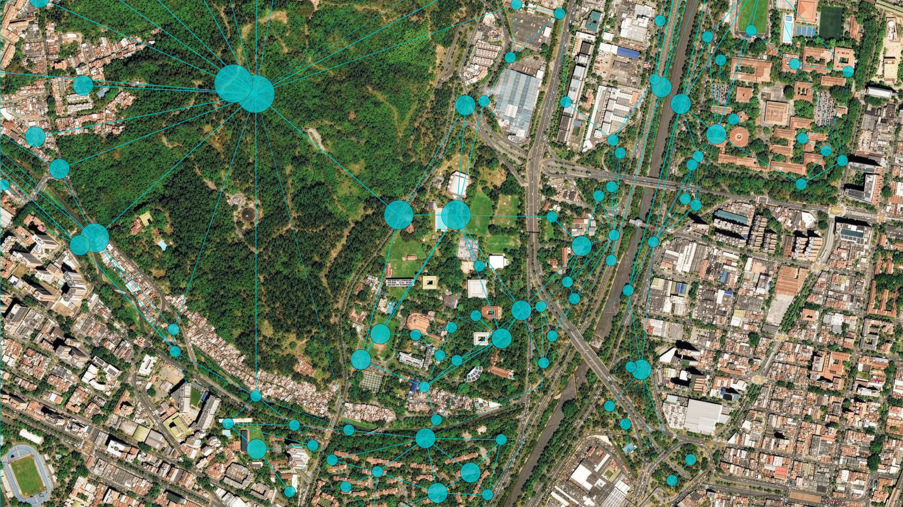
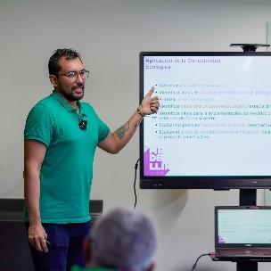
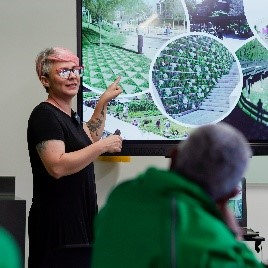
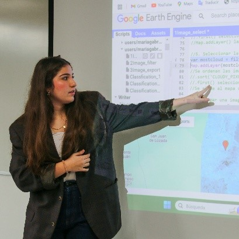

```{=html}
<section class="simposio-detalle-container">

<div class="detalle-breadcrumb">
<a href="../../index.html">⌂</a>
<span class="separator">›</span>
<a href="../../cursos.html">Cursos</a>
<span class="separator">›</span>
<span class="current">Conectividad Ecológica</span>
</div>

<article class="detalle-card">
<div class="detalle-grid">

<div class="col-izquierda">
<div class="imagen-card">

<div class="pie-foto">
📷 Conectividad Ecológica.
</div>
</div>

<div class="organizadores-info">
<h3>Organizan</h3>
<ul class="lista-organizadores">
<li>Carlos Eduardo Ortiz Yusty</li>
<li>Diana Marcela Cardona Ramirez</li>
<li>María Camila Aduén Espinosa</li>
</ul>
<div class="badge-simposio">Modelamiento de Conectividad Ecológica Funcional en Evaluación de Impacto Ambiental.</div>
</div>

<div class="simposio-logos" >

</div>
</div>

<div class="col-derecha">
<h1>Modelamiento de Conectividad Ecológica Funcional en Evaluación de Impacto Ambiental.</h1>
<div class="subtitulo">VI Congreso Colombiano de Mastozoología · Amazonía 2026</div>

<div class="objetivos">
<h2>Objetivos</h2>
<ul class="lista-objetivos">
<li>Comprender los principios ecológicos y metodológicos que sustentan el análisis de conectividad del paisaje.</li>
<li>Introducir las herramientas de modelamiento de conectividad ecológica en el marco de estudios de impacto ambiental.</li>
<li>Interpretar y comunicar resultados de conectividad para apoyar la gestión ambiental y las decisiones de compensación ecológica.</li>
<li>Implementar enfoques metodológicos basados en rutas de menor costo y teoría de circuitos, aplicables a escenarios de impacto y conservación</li>
</ul>
</div>

<div class="resumen">
<h2>Resumen</h2>
<p>El modelamiento de la conectividad ecológica se ha consolidado como una herramienta clave para identificar, evaluar y mitigar los impactos de proyectos de infraestructura sobre la biodiversidad y los procesos ecológicos a escala de paisaje. En el contexto de los Estudios de Impacto Ambiental (EIA), los modelos de conectividad permiten comprender cómo las obras de infraestructura y las actividades productivas modifican la funcionalidad del paisaje y afectan la integridad ecológica de los ecosistemas, particularmente la capacidad de movimiento de mamíferos entre fragmentos de hábitat. Este curso ofrece un enfoque teórico-práctico orientado a fortalecer las capacidades técnicas de profesionales en consultoría ambiental, biología, ecología del paisaje y ordenamiento territorial. Se abordarán los fundamentos ecológicos, espaciales y algorítmicos del análisis de conectividad, así como la aplicación práctica de modelos que integran información ecológica y geoespacial para analizar escenarios de impacto, conservación y restauración del paisaje. Se promoverá la interpretación crítica de resultados como insumo para la toma de decisiones en planificación ambiental, diseño de medidas de compensación y restauración ecológica.</p>


    <!-- ==== fin instructor 1 ==== -->
<div class="wrap">
  <h1 class="section-title">Instructores</h1>
 
  <div class="list">
    <details class="instructor">
      <summary class="row">
        <div class="row-text">
          <p class="name">Carlos Eduardo Ortiz Yusty</p>
          <p class="role">PhD. Cuántico - Global Eco Services. Colombia</p>
        </div>
      </summary>
      <div class="panel-inner">
        <div class="expand-card">
          <div class="card-top">
            <div class="avatar">
              
            </div>
          </div>
          <div class="card-body">
            <p class="name">Carlos Eduardo Ortiz Yusty</p>
            <p class="role"> Cuántico – Global Eco Services</p>
 
            <div class="credential-row">
              <span class="credential">MSc. Bosques y Conservación Ambiental </span>
              <span class="credential">PhD. Cuántico</span>
            </div>
             <p class="bio">
              Biólogo de la Universidad del Valle, con Maestría en Bosques y Conservación Ambiental y Doctor en Ecología de la Universidad Nacional de Colombia. Su trayectoria investigativa y profesional se centra en la ecología espacial, evaluación de impactos sobre la biodiversidad y el modelamiento de la conectividad ecológica funcional. Cuenta con amplia experiencia en el manejo de Sistemas de Información Geográfica (SIG), uso de sensores remotos en ecología y conservación, análisis espacial y software especializado como Circuitscape, Graphab y R. Actualmente, se desempeña como coordinador de proyectos y director científico en Cuántico - Global Eco Services S.A.S., y cuenta con experiencia en la Autoridad Nacional de Licencias Ambientales (ANLA) evaluando el componente de conectividad y fragmentación del paisaje para estudios de impacto ambiental (EIA)
            </p>
             <div class="tools">
              </div>
            </div>
        </div>
      </div>
    </details>
    </div>
    </div>
    <!-- ==== fin instructor 1 ==== -->
 
 
 
    <!-- ==== fin instructor 2 ==== -->
<div class="wrap">
  
  <div class="list">
    <details class="instructor">
      <summary class="row">
        <div class="row-text">
          <p class="name">Diana Marcela Cardona Ramirez</p>
          <p class="role">Cuántico - Global Eco Services. Colombia</p>
        </div>
      </summary>
      <div class="panel-inner">
        <div class="expand-card">
          <div class="card-top">
            <div class="avatar">
              
            </div>
          </div>
          <div class="card-body">
            <p class="name">Diana Marcela Cardona Ramirez</p>
            <p class="role"> Cuántico – Global Eco Services</p>
 
            <div class="credential-row">
              <span class="credential">Esp. Sistemas de Información Geográfica (SIG)</span>
              <span class="credential">MSc. Magíster en Biodiversidad en Áreas Tropicales y su Conservación.</span>
            </div>
             <p class="bio">
              Bióloga de la Universidad de Caldas, Especialista en Sistemas de Información Geográfica (SIG) y Magíster en Biodiversidad en Áreas Tropicales y su Conservación. Acumula más de 10 años de experiencia liderando proyectos de investigación aplicada en gestión de la biodiversidad, ecología del paisaje, análisis de fragmentación y modelamiento de la conectividad ecológica. Desde 2019 se desempeña como directora general en Cuántico - Global Eco Services y ha ejecutado proyectos estratégicos para entidades como el Instituto Alexander von Humboldt, el Área Metropolitana del Valle de Aburrá y Corantioquia. Adicionalmente, cuenta con una sólida trayectoria investigativa en fauna silvestre, destacándose como líder del Programa para la Conservación de los Murciélagos de Colombia (PCMco) y la Red Latinoamericana y del Caribe para la Conservación de los Murciélagos (RELCOM).
            </p>
             <div class="tools">
              </div>
            </div>
        </div>
      </div>
      </div>
    </div>
    </details>
    <!-- ==== fin instructor 2 ==== -->
 
 
    <!-- ==== fin instructor 3 ==== -->
<div class="wrap">
  
  <div class="list">
    <details class="instructor">
      <summary class="row">
        <div class="row-text">
          <p class="name">Maria Gabriela Aduén Espinosa</p>
          <p class="role">Cuántico - Global Eco Services. Colombia</p>
        </div>
      </summary>
      <div class="panel-inner">
        <div class="expand-card">
          <div class="card-top">
            <div class="avatar">
              
            </div>
          </div>
          <div class="card-body">
            <p class="name">Maria Gabriela Aduen Espinosa</p>
            <p class="role"> Cuántico – Global Eco Services</p>
 
            <div class="credential-row">
              <span class="credential">Ecóloga</span>
              <span class="credential">Estudiante. Magíster observación y Uso de la Biodiversidad de la Pontificia Universidad Javeriana.</span>
            </div>
             <p class="bio">
             Ecóloga y estudiante de la Maestría en Conservación y Uso de la Biodiversidad de la Pontificia Universidad Javeriana. Como investigadora, aplica enfoques metodológicos que integran los valores sociales del paisaje al análisis espacial para el diseño participativo de rutas de conectividad. Posee experiencia en la gestión de proyectos socioambientales, combinando el rigor técnico con metodologías participativas y educación ambiental en contextos interculturales. Se destaca por la coordinación del Semillero de Investigación Ecología del Paisaje en el Antropoceno, donde implementa herramientas de análisis espacial y SIG participativo para estudios de conectividad ecológica y priorización de áreas de conservación. Cuenta con habilidades en el manejo de software especializado y lenguajes de programación, incluyendo ArcGIS Pro, QGIS, Fragstats, Google Earth Engine y R. En Cuántico - Global Eco Services se desempeña como científica de datos espaciales ejecutando análisis de conectividad ecológica en estudios de impacto ambiental en ambientes acuáticos y terrestres.
            </p>
             <div class="tools">
              </div>
            </div>
        </div>
      </div>
      </div>
    </div>
    </details>
    <!-- ==== fin instructor 3 ==== -->
    
    
    
  <div class="boton">
    <div class="buttons">
      <a class="btn btn-primary" href="https://cuantico.com.co/congreso-mastozoologia-2026/" target="_blank" rel="noopener">
        <span>
          <span class="btn-title">Ver descripción del curso</span>
          <span class="btn-desc">Programa, temática y ponentes del congreso</span>
        </span>
        <span class="btn-arrow">→</span>
      </a>
 
      <a class="btn btn-secondary" href="https://forms.cloud.microsoft/r/UTKefeDAy6" target="_blank" rel="noopener">
        <span>
          <span class="btn-title">Inscribirme al curso</span>
          <span class="btn-desc">Formulario oficial de inscripción</span>
        </span>
        <span class="btn-arrow">→</span>
      </a>
    </div>
 

  </div>


<a href="../../cursos.html" class="btn-volver">← Volver a todos los cursos</a>
</div>

</div>
</article>
</section>
```
<script src="c3_modelamiento_conectividad.js"></script>
