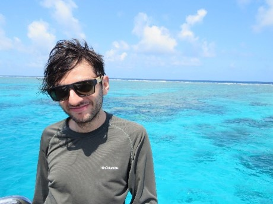

```{=html}
<section class="simposio-detalle-container">

<div class="detalle-breadcrumb">
<a href="../../index.html">⌂</a>
<span class="separator">›</span>
<a href="../../cursos.html">Cursos</a>
<span class="separator">›</span>
<span class="current">Procesamiento, Visualización y Análisis de Datos Espaciales en R</span>
</div>

<article class="detalle-card">
<div class="detalle-grid">

<div class="col-izquierda">
<div class="imagen-card">

<div class="pie-foto">
📷 Análisis de datos espaciales de mamíferos con herramientas R
</div>
</div>

<div class="organizadores-info">
<h3>Organizan</h3>
<ul class="lista-organizadores">
<li>Diego J. Lizcano</li>
<li>Andrés Felipe Suárez Castro</li>
</ul>
<div class="badge-simposio">Procesamiento, Visualización y Análisis de Datos Espaciales en R</div>
</div>
</div>

<div class="col-derecha">
<h1>Procesamiento, visualización y análisis de datos espaciales en R.</h1>
<div class="subtitulo">VI Congreso Colombiano de Mastozoología · Amazonía 2026</div>

<div class="objetivos">
<h2>Objetivo</h2>
<p>Proporcionar capacitación en el procesamiento, visualización y mapeo de datos espaciales utilizando R. El curso se centra en un pequeño conjunto de paquetes populares para estas tareas, muchos de los cuales pertenecen a una colección de paquetes denominada tidyverse. Mediante el uso de un estudio de caso con mamíferos neotropicales, los participantes de este aprenderán herramientas básicas sobre cómo convertir fácilmente sus datos en un formato "ordenado", lo que facilita la verificación y el análisis de errores. También crearemos algunos gráficos para resumir los datos y exploraremos varias opciones para la creación de mapas.</p>
</div>

<div class="resumen">
<h2>Resumen</h2>
<p>Durante el curso, se presentarán diferentes estrategias que facilitan la detección de errores, la creación de gráficos y el resumen de grandes bases de datos para el análisis de biodiversidad. Además, se mostrarán ejemplos utilizando datos del Global Biodiversity Information Facility (GBIF) explicando los paquetes disponibles para agilizar el procesamiento de estos datos.Todos estos temas estarán soportados con ejemplos relevantes para el mundo de la mastozoología, pero que podrán ser extrapolados a otros grupos y a temas relevantes en ecología y conservación.</p>


<!-- ==== fin instructor 1 ==== -->
<div class="wrap">
  <h1 class="section-title">Instructores</h1>
 
  <div class="list">
    <details class="instructor">
      <summary class="row">
        <div class="row-text">
          <p class="name">Diego J. Lizcano.</p>
          <p class="role">Wildlife Conservation Society (WCS). Colombia</p>
        </div>
      </summary>
      <div class="panel-inner">
        <div class="expand-card">
          <div class="card-top">
            <div class="avatar">
              
            </div>
          </div>
          <div class="card-body">
            <p class="name">Diego J. Lizcano.</p>
            <p class="role"> Wildlife Conservation Society (WCS). Colombia</p>
 
            <div class="credential-row">
              <span class="credential">PhD. Biología, University of Kent, UK</span>
            </div>
             <p class="bio">
              Experiencia en ecología, monitoreo de vida silvestre y conservación de la biodiversidad, utilizo herramientas como cámaras trampa, estudios acústicos y modelado de datos para orientar decisiones informadas en conservación de biodiversidad y medir el impacto ambiental.
            </p>
             <div class="tools">
              </div>
            </div>
        </div>
      </div>
    </details>
    </div>
    </div>
    <!-- ==== fin instructor 1 ==== -->
 
 
 
    <!-- ==== fin instructor 2 ==== -->
<div class="wrap">
  
  <div class="list">
    <details class="instructor">
      <summary class="row">
        <div class="row-text">
          <p class="name">Andrés Felipe Suárez Castro</p>
          
        </div>
      </summary>
      <div class="panel-inner">
        <div class="expand-card">
          <div class="card-top">
            <div class="avatar">
              
            </div>
          </div>
          <div class="card-body">
            <p class="name">Andrés Felipe Suárez Castro</p>
            
 
            <div class="credential-row">
              <span class="credential">PhD. Biología The University of Queensland (Australia</span>
              
            </div>
             <p class="bio">
             Uso modelos para explorar los factores que impulsan los patrones de distribución de las especies, el efecto del cambio del paisaje en la biodiversidad, servicios ecosistémicos, y la interfaz ciencia-política.
            </p>
             <div class="tools">
              </div>
            </div>
        </div>
      </div>
      </div>
    </div>
    </details>
    <!-- ==== fin instructor 2 ==== -->
 
 
</div>

<a href="../../cursos.html" class="btn-volver">← Volver a todos los cursos</a>
</div>

</div>
</article>
</section>
```
<script src="c4_procesamiento.js"></script>
