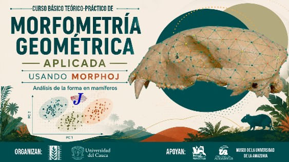
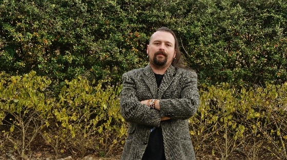

```{=html}
<section class="simposio-detalle-container">

<div class="detalle-breadcrumb">
<a href="../../index.html">⌂</a>
<span class="separator">›</span>
<a href="../../cursos.html">Cursos</a>
<span class="separator">›</span>
<span class="current">Básico teórico-práctico de morfometría</span>
</div>

<article class="detalle-card">
<div class="detalle-grid">

<div class="col-izquierda">
<div class="imagen-card">

<div class="pie-foto">
📷 Morfometría geométrica para el estudio de la forma en mamíferos.
</div>
</div>


<div class="organizadores-info">
<h3 class="anchored">Organizan</h3>
<ul class="lista-organizadores">
<li>Nicolas Reyes-Amaya</li>
<li>Alejandra Pardo</li>
<li>Paula Calambas Pizo</li>
</ul>
<div class="badge-simposio">Curso básico teórico-práctico de morfometría geométrica aplicada usando MorphoJ</div>
</div>


<div class="simposio-logos" >


</div>
</div>


<div class="col-derecha">
<h1>Curso básico teórico-práctico de morfometría geométrica aplicada usando MorphoJ</h1>
<div class="subtitulo">VI Congreso Colombiano de Mastozoología · Amazonía 2026</div>

<div class="objetivos">
<h2>Objetivos General</h2>
<p>Capacitar a los participantes en los fundamentos teóricos y prácticos de la morfometría geométrica basada en landmarks, mediante el uso del software MorphoJ, para el análisis preliminar de la variación de la forma en mamíferos.</p>
<h2>Objetivos Especifícos</h2>
<ul class="lista-objetivos">
<li>Introducir los conceptos básicos de la morfometría geométrica y la importancia del estudio de la forma en organismos biológicos.</li>
<li>Enseñar la adquisición de datos mediante digitalización de landmarks y la construcción del dataset para análisis morfométricos.</li>
<li>Desarrollar el flujo básico de análisis en MorphoJ, incluyendo alineación Procrustes, detección de outliers, generación de matrices de covarianza y análisis multivariados (PCA y CVA).</li>
<li>Evaluar la variación de la forma mediante análisis de alometría, cálculo de formas promedio y visualización de cambios morfológicos con wireframes.</li>
<li>Introducir el análisis preliminar de simetría, así como conceptos básicos de integración y modularidad morfológica a partir de configuraciones de landmarks.</li>
</ul>
</div>

<div class="resumen">
<h2>Resumen</h2>
<p>Este curso teórico-práctico tiene como propósito capacitar a los participantes en los fundamentos y aplicaciones de la morfometría geométrica basada en landmarks mediante el uso del software MorphoJ, proporcionando las bases necesarias para el análisis preliminar de la variación de la forma en mamíferos. A partir de una combinación de conceptos teóricos y ejercicios guiados, los asistentes aprenderán a desarrollar el flujo completo de trabajo, desde la digitalización de landmarks y la construcción de conjuntos de datos hasta la interpretación de análisis morfométricos multivariados.</p>

<p>Durante el curso se abordarán procedimientos fundamentales como la alineación Generalized Procrustes, la detección de valores atípicos, el análisis de componentes principales (ACP), el análisis de variación canónica (AVC), la evaluación de alometría, el cálculo de formas promedio y la visualización de cambios morfológicos mediante wireframes. Asimismo, se introducirán conceptos básicos de simetría, integración y modularidad morfológica.</p>

<p>La metodología se basa en el aprendizaje práctico, permitiendo que cada participante ejecute los análisis en tiempo real utilizando un conjunto de datos de ejemplo y reciba acompañamiento permanente durante todo el proceso. Al finalizar, los asistentes contarán con un flujo de trabajo reproducible y aplicable a estudios comparativos de biodiversidad, sistemática y evolución, fortaleciendo sus competencias en el análisis cuantitativo de la variación morfológica.</p>


 <!-- ==== fin instructor 1 ==== -->
<div class="wrap">
  <h1 class="section-title">Instructores</h1>
 
  <div class="list">
    <details class="instructor">
      <summary class="row">
        <div class="row-text">
          <p class="name">Daniel Nicolás Rafael Reyes-Amaya</p>
          <p class="role">Curador colección de mamíferos (IAvH-M) </p>
        </div>
      </summary>
      <div class="panel-inner">
        <div class="expand-card">
          <div class="card-top">
            <div class="avatar">
              
            </div>
          </div>
          <div class="card-body">
            <p class="name">Carlos Eduardo Ortiz Yusty</p>
            <p class="role"> </p>
 
            <div class="credential-row">
              <span class="credential">Biólogo de la Universidad Industrial de Santander (Colombia) </span>
              <span class="credential">PhD en Ciencias Biológicas </span>
            </div>
             <p class="bio">
              Nicolás Reyes-Amaya, PhD en Ciencias Biológicas con énfasis en Evolución de la Universidad Nacional de Córdoba (Argentina), Biólogo de la Universidad Industrial de Santander (Colombia). Curador de la Colección de Mamíferos del Instituto Humboldt (IAvH-M) y Líder de la "Agenda One Health" del mismo Instituto. Delegado del equipo asesor ante la sentencia del Rio Atrato (T-622) de la Corte Constitucional y Miembro del grupo de expertos en Oso Andino de la Unión Internacional para el Cuidado de la Naturaleza (ABET-UICN). Mastozoólogo, con líneas de investigación en biología evolutiva del desarrollo, morfología funcional y evolución de pequeños mamíferos, así como ecología y conservación de grandes mamíferos.
            </p>
             <div class="tools">
              </div>
            </div>
        </div>
      </div>
    </details>
    </div>
    </div>
    <!-- ==== fin instructor 1 ==== -->
    
    
     <!-- ==== fin instructor 2 ==== -->
<div class="wrap">
  
  <div class="list">
    <details class="instructor">
      <summary class="row">
        <div class="row-text">
          <p class="name">Alejandra Pardo Martínez</p>
          <p class="role">Docente del Programa Antropología y del Programa Biología</p>
        </div>
      </summary>
      <div class="panel-inner">
        <div class="expand-card">
          <div class="card-top">
            <div class="avatar">
              
            </div>
          </div>
          <div class="card-body">
            <p class="name">Alejandra Pardo Martínez</p>
            <p class="role"> </p>
 
            <div class="credential-row">
              <span class="credential">Docente de la Universidad del Magdalena</span>
              <span class="credential">Especializada en mamíferos y primatología</span>
            </div>
             <p class="bio">
              Miembro de la Asociación Primatológica Colombiana, ha realizado estudios sobre el comportamiento, la conservación y la ecología de los primates. Su experiencia incluye el monitoreo de grupos de primates en el campo, la estimación de densidades poblacionales y el análisis de hormonas esteroides en metabolitos fecales asociados al comportamiento reproductivo. También ha llevado a cabo investigaciones fisiológicas, anatómicas y morfológicas, con énfasis en los patrones craneales, el dimorfismo del desarrollo y las relaciones entre ontogenia y filogenia en primates platirrinos.
            </p>
             <div class="tools">
              </div>
            </div>
        </div>
      </div>
    </details>
    </div>
    </div>
    <!-- ==== fin instructor 2 ==== -->
    
    


</div>

<a href="../../cursos.html" class="btn-volver">← Volver a todos los cursos</a>
</div>

</div>
</article>
</section>
```
<script src="c6_basico.js"></script>
