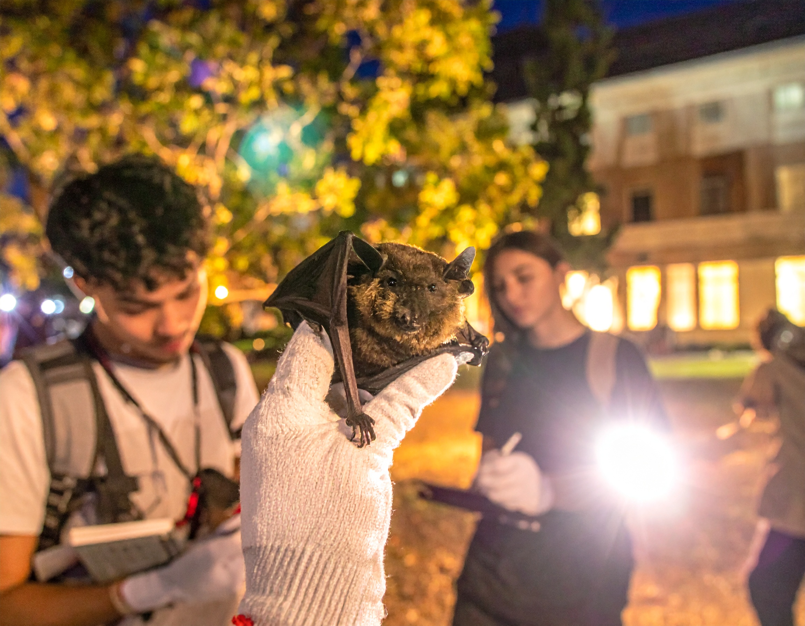
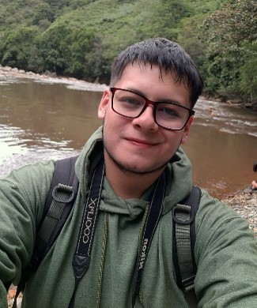
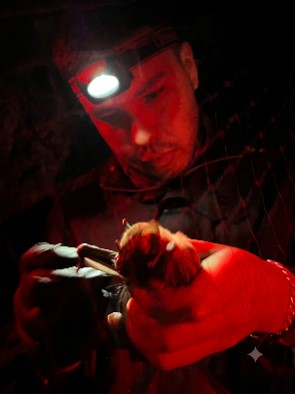
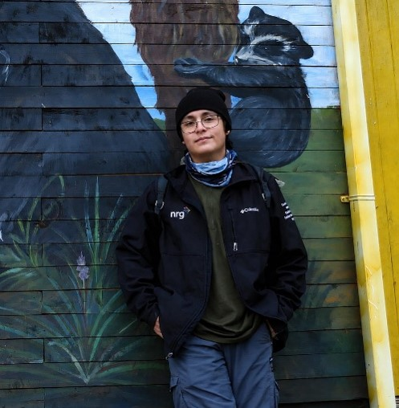

```{=html}
<section class="simposio-detalle-container">

<div class="detalle-breadcrumb">
<a href="../../index.html">⌂</a>
<span class="separator">›</span>
<a href="../../cursos.html">Talleres</a>
<span class="separator">›</span>
<span class="current">Murcielloween</span>
</div>

<article class="detalle-card">
<div class="detalle-grid">

<div class="col-izquierda">
<div class="imagen-card">

<div class="pie-foto">
📷 Ciencia participativa para la conservación de murciélagos en contextos urbanos.
</div>
</div>

<div class="organizadores-info">
<h3>Organizan</h3>
<ul class="lista-organizadores">
<li>Kevin Alexander Ramírez</li>
<li>Joseph Alejandro Romero</li>
<li>Cesar Camilo Castillo</li>
<li>Charles S. Muñoz Nates</li>
</ul>
<div class="badge-simposio">Murcielloween: Investigación participativa para la conservación de murciélagos en entornos urbanos</div>
</div>
</div>

<div class="col-derecha">
<h1>Murcielloween: Investigación Participativa para la Conservación de Murciélagos en Entornos Urbanos</h1>
<div class="subtitulo">VI Congreso Colombiano de Mastozoología · Florencia 2026</div>

<div class="objetivos">
<h2>Objetivos General</h2>
<p>Promover el conocimiento y la valoración de la quiropterofauna en entornos urbanos mediante una iniciativa participativa que fomente la sensibilización y participación activa de la comunidad universitaria y de la sociedad en general.</p>
<h2>Objetivos Especifícos</h2>
<ul class="lista-objetivos">
<li>Caracterizar la composición de especies de murciélagos presentes en el ambiente urbano de estudio, a través de la implementación de muestreo e identificación taxonómica.</li>
<li>Fomentar la concientización sobre la importancia ecológica de los murciélagos y su rol funcional en los ecosistemas urbanos.</li>
<li>Incentivar la participación de la comunidad en general en procesos de aprendizaje y apropiación social del conocimiento sobre la quiropterofauna.</li>
</ul>
</div>

<div class="resumen">
<h2>Resumen</h2>
<p>El taller "Murcielloween", surge como una iniciativa de ciencia participativa desarrollada por la Universidad del Cauca para generar conocimiento sobre los murciélagos en entornos urbanos, dada la escasez de información sobre la quiropterofauna del campus y la necesidad de valorar este grupo biológico. Su objetivo general es promover el conocimiento y la valoración de los murciélagos mediante la sensibilización y participación activa de la comunidad universitaria y la sociedad. Específicamente, busca caracterizar las especies presentes a través de muestreo e identificación taxonómica, fomentar la concientización sobre su importancia ecológica e incentivar la participación comunitaria en procesos de aprendizaje. La justificación parte de que la sensibilización hacia fauna estigmatizada es clave para la conservación, ofreciendo una experiencia teórico-práctica que derriba mitos y genera actitudes proactivas, proyectándose como recurso pedagógico replicable. La metodología combina tres momentos: una charla interactiva de desestigmatización, un acercamiento perceptual con especímenes de exhibición y una introducción al instrumental técnico. Luego se realizan salidas de campo con redes de niebla además del registro morfológico de individuos, construcción de base de datos y elaboración de fichas técnicas. La estrategia es inclusiva con una convocatoria abierta sin requisitos previos, roles diversos para vincular personas con diferentes capacidades y espacios formativos con lenguaje accesible, fortaleciendo así el vínculo entre ciencia y sociedad.</p>


<!-- ==== inicio instructor 1 ==== -->
<div class="wrap">
  <h1 class="section-title">Instructores</h1>
 
  <div class="list">
    <details class="instructor">
      <summary class="row">
        <div class="row-text">
          <p class="name">Cesar Camilo Castillo</p>
          <p class="role">Universidad del Cauca - Colombia</p>
        </div>
      </summary>
      <div class="panel-inner">
        <div class="expand-card">
          <div class="card-top">
            <div class="avatar">
              
            </div>
          </div>
          <div class="card-body">
            <p class="name">Cesar Camilo Castillo</p>
            <p class="role"> </p>
 
            <div class="credential-row">
              <span class="credential"> </span>
              <span class="credential"> </span>
            </div>
             <p class="bio">
             Estudiante de octavo semestre de Biología en la Universidad del Cauca, con interés en la investigación en Ecología, Mastozoología, Entomología y análisis de datos aplicados a la biodiversidad. He participado en actividades de campo, incluyendo muestreos de fauna y levantamiento de información biológica en diferentes ecosistemas de Colombia. Además, trabajo en el Museo de Historia Natural de la Universidad del Cauca, donde realizo curaduría y manejo de la colección de mastozoología, fortaleciendo mis competencias en conservación, sistemática y gestión de colecciones. He desarrollado habilidades en el manejo de bases de datos, sistemas de información geográfica (ArcGIS y QGIS), análisis de información científica y redacción académica. Actualmente busco fortalecer mi formación mediante cursos especializados en análisis de datos y herramientas computacionales, con el propósito de contribuir a la investigación, conservación y toma de decisiones basadas en evidencia para el estudio de la biodiversidad.
            </p>
             <div class="tools">
              </div>
            </div>
        </div>
      </div>
    </details>
    </div>
    </div>
    <!-- ==== fin instructor 1 ==== -->
    
    
<!-- ==== inicio instructor 2 ==== -->
<div class="wrap">

  <div class="list">
    <details class="instructor">
      <summary class="row">
        <div class="row-text">
          <p class="name">Kevin Alexander Ramírez</p>
          <p class="role"> Universidad del Cauca - Colombia </p>
        </div>
      </summary>
      <div class="panel-inner">
        <div class="expand-card">
          <div class="card-top">
            <div class="avatar">
              
            </div>
          </div>
          <div class="card-body">
            <p class="name">Cesar Camilo Castillo</p>
            <p class="role"> </p>
 
            <div class="credential-row">
              <span class="credential"></span>
              <span class="credential"> </span>
            </div>
             <p class="bio">
            Estudiante de Biología de la Universidad del Cauca, actualmente enfocado en mi trabajo de grado, el cual explora la diversidad funcional de murciélagos en distintos estados sucesionales de bosque seco tropical. Mi vocación investigativa se consolidó en el Semillero de Investigación en Geología, Ecología y Conservación (ASIO), donde dirigí mi interés hacia la zoología y, en particular, la quiropterología. Como parte de este proceso, diseñé e impulsé Murcieloween, una iniciativa que integra el monitoreo científico de quirópteros con la educación ambiental y la desestigmatización de estas especies, demostrando mi capacidad para articular la investigación con el impacto social. Además de mi formación técnica, he cultivado competencias en pensamiento crítico, liderazgo y trabajo colaborativo, reflejadas en mi rol como organizador del XVIII Simposio de Investigaciones en Ciencias Biológicas. Mi trayectoria refleja un firme compromiso con la generación de conocimiento, el aprendizaje constante y la divulgación científica, pilares que guían mi propósito de aportar significativamente a la conservación de la biodiversidad.
            </p>
             <div class="tools">
              </div>
            </div>
        </div>
      </div>
    </details>
    </div>
    </div>
    <!-- ==== fin instructor 2 ==== -->
    
<!-- ==== inicio instructor 3 ==== -->
<div class="wrap">

  <div class="list">
    <details class="instructor">
      <summary class="row">
        <div class="row-text">
          <p class="name">Joseph Alejandro Romero</p>
          <p class="role"> Universidad del Cauca - Colombia </p>
        </div>
      </summary>
      <div class="panel-inner">
        <div class="expand-card">
          <div class="card-top">
            <div class="avatar">
              
            </div>
          </div>
          <div class="card-body">
            <p class="name">Joseph Alejandro Romer</p>
            <p class="role"> </p>
 
            <div class="credential-row">
              <span class="credential"></span>
              <span class="credential"> </span>
            </div>
             <p class="bio">
         Estudiante de Biología en la Universidad del Cauca, con interés en Ecología, Conservación, Biogeografía y Mastozoología. Mi experiencia se ha enfocado en proyectos de investigación y monitoreo de fauna asociados a obras de infraestructura, así como en estudios sobre distintos grupos de fauna y análisis de datos ecológicos mediante herramientas estadísticas. He participado en la revisión e identificación de especímenes de quirópteros en la Colección de Mastozoología del Museo de Historia Natural de la Universidad del Cauca. Actualmente coordino el Semillero de Investigación en Geología, Ecología y Conservación (ASIO) y participo como guía del museo de historia natural de la Universidad, promoviendo la formación investigativa y la apropiación social del conocimiento. Mi interés profesional se orienta a la investigación aplicada para comprender los patrones de distribución de la biodiversidad y contribuir a su conservación y manejo sostenible.
            </p>
             <div class="tools">
              </div>
            </div>
        </div>
      </div>
    </details>
    </div>
    </div>
    <!-- ==== fin instructor 3 ==== -->
    
    
<!-- ==== inicio instructor 4 ==== -->
<div class="wrap">

  <div class="list">
    <details class="instructor">
      <summary class="row">
        <div class="row-text">
          <p class="name">Charles S. Muñoz Nates</p>
          <p class="role"> Universidad del Cauca - Colombia </p>
        </div>
      </summary>
      <div class="panel-inner">
        <div class="expand-card">
          <div class="card-top">
            <div class="avatar">
              
            </div>
          </div>
          <div class="card-body">
            <p class="name">Charles S. Muñoz Nates</p>
            <p class="role"> </p>
 
            <div class="credential-row">
              <span class="credential"></span>
              <span class="credential"> </span>
            </div>
             <p class="bio">
        Biólogo de la Universidad del Cauca y Magíster en Sistemática, Evolución y Paleobiodiversidad. Profesor del departamento de Biología, curador de la Colección de Mamíferos del Museo de Historia Natural y pertenece al Grupo de Estudios en Geología, Ecología y Conservación (GECO) de la Universidad del Cauca. Su labor académica e investigativa se centra en la Zoología, la biodiversidad y la conservación de la fauna silvestre. Sus resultados de investigación han sido publicados en revistas científicas y divulgados en eventos científicos, mediante los cuales promueve la investigación, la conservación y la apropiación social del conocimiento sobre el patrimonio natural.
            </p>
             <div class="tools">
              </div>
            </div>
        </div>
      </div>
    </details>
    </div>
    </div>
    <!-- ==== fin instructor 4 ==== -->
    
    </div>

<h2>Instagram</h2>
 <div class="redes-iconos">

                <a href="http://https://www.instagram.com/asio_unicauca " class="red-social instagram"
                   target="_blank" aria-label="Instagram">
                    <i class="fa-brands fa-instagram"></i>
                </a>
                <a href="http://https://www.instagram.com/lavicecb" class="red-social instagram"
                   target="_blank" aria-label="Instagram">
                    <i class="fa-brands fa-instagram"></i>
                </a>
                

</div>


<a href="../../cursos.html" class="btn-volver">← Volver a todos los talleres</a>
</div>

</div>

</div>
</article>
</section>
```
<script src="t3_murcielloween.js"></script>
