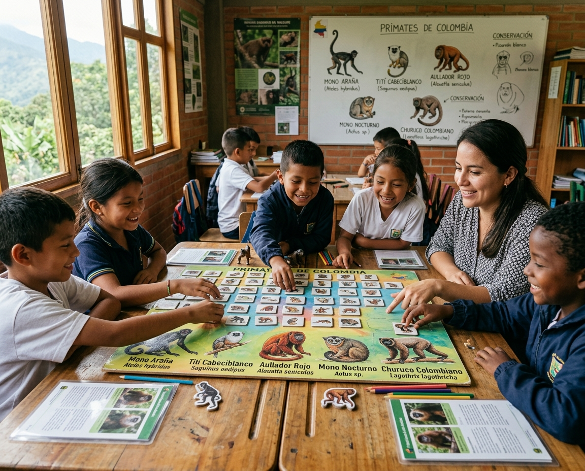
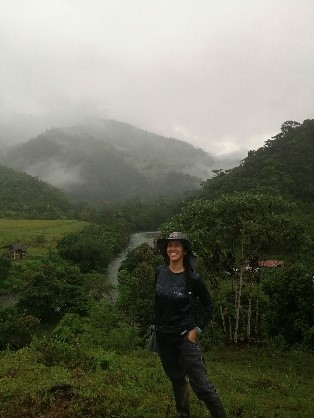
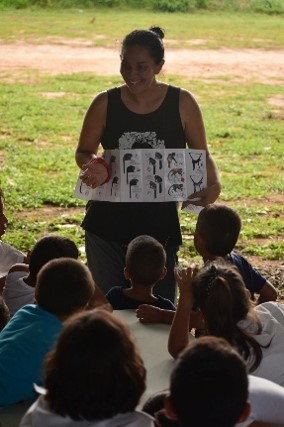
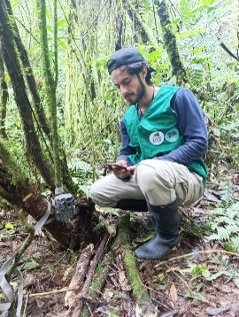

```{=html}
<section class="simposio-detalle-container">

<div class="detalle-breadcrumb">
<a href="../../index.html">⌂</a>
<span class="separator">›</span>
<a href="../../cursos.html">Talleres</a>
<span class="separator">›</span>
<span class="current">Jugar para aprender: el arte de conocer nuestros primates.</span>
</div>

<article class="detalle-card">
<div class="detalle-grid">

<div class="col-izquierda">
<div class="imagen-card">

<div class="pie-foto">
📷  Jugar para aprender: el arte de conocer nuestros primates.
</div>
</div>

<div class="organizadores-info">
<h3>Organizan</h3>
<ul class="lista-organizadores">
<li>Alma Hernández</li>
<li>Caralina Orrego</li>
</ul>
<div class="badge-simposio">ConozcáMonos: Aprende sobre Ecología y Conservación de Monos de Colombia</div>
</div>
</div>

<div class="col-derecha">
<h1>ConozcáMonos: aprende sobre ecología y conservación de monos de Colombia</h1>
<div class="subtitulo">VI Congreso Colombiano de Mastozoología · Florencia 2026</div>

<div class="resumen">
<h2>Resumen</h2>
<p>El orden Primates es uno de los más amenazados a nivel global principalmente por la pérdida de su hábitat, extracción como mascotas y cacería, la mayoría de las especies de monos están en alguna categoría de amenaza según la UICN. En Colombia se han registrado 42 especies de primates, agrupadas en 15 géneros y cuatro familias, al menos 8 de ellas endémicas de nuestro país. El desconocimiento de los monos presentes en Colombia y de su ecología es muy amplio y esto también es una amenaza para si conservación. A través de una charla breve, actividades dinámicas arte y juegos educativos queremos aumentar el conocimiento y el interés de los asistentes, sobre las especies de primates en Colombia y su conservación.</p>


    <!-- ==== fin instructor 1 ==== -->
<div class="wrap">
  <h1 class="section-title">Instructores</h1>
 
  <div class="list">
    <details class="instructor">
      <summary class="row">
        <div class="row-text">
          <p class="name">Catalina Orrego</p>
          <p class="role">Neotropical Primate Conservation Colombia</p>
        </div>
      </summary>
      <div class="panel-inner">
        <div class="expand-card">
          <div class="card-top">
            <div class="avatar">
              
            </div>
          </div>
          <div class="card-body">
            <p class="name">Catalina Orrego</p>
            <p class="role"> </p>
 
            <div class="credential-row">
              <span class="credential"> </span>
              <span class="credential"></span>
            </div>
             <p class="bio">
              Bióloga con énfasis en biología de la conservación y experiencia en investigación, educación ambiental y docencia. Ha participado en proyectos de conservación de primates en Colombia y Perú, desarrollando actividades de monitoreo de poblaciones, ecología, trabajo comunitario y educación ambiental. Su trayectoria incluye la conservación de especies amenazadas, la protección de ecosistemas y el fortalecimiento de iniciativas voluntarias de conservación, en articulación con asociaciones comunitarias, universidades, organizaciones no gubernamentales, autoridades ambientales y empresas privadas. Como docente, ha orientado asignaturas de biología, ecología y conservación, promoviendo el pensamiento crítico y el aprendizaje basado en experiencias de investigación y trabajo de campo. Su propósito es contribuir al fortalecimiento de los procesos de conservación liderados por las comunidades e incentivar en niños, niñas y jóvenes el reconocimiento, la valoración y el cuidado de la naturaleza.
            </p>
             <div class="tools">
              </div>
            </div>
        </div>
      </div>
    </details>
    </div>
    </div>
    <!-- ==== fin instructor 1 ==== -->
   
    
    <!-- ==== fin instructor 2 ==== -->
<div class="wrap">
    <div class="list">
    <details class="instructor">
      <summary class="row">
        <div class="row-text">
          <p class="name">Alma Hernández Jaramillo</p>
          <p class="role">Neotropical Primate Conservation Colombia</p>
        </div>
      </summary>
      <div class="panel-inner">
        <div class="expand-card">
          <div class="card-top">
            <div class="avatar">
              
            </div>
          </div>
          <div class="card-body">
            <p class="name">Alma Hernández Jaramillo</p>
            <p class="role"> </p>
 
            <div class="credential-row">
              <span class="credential"> </span>
              <span class="credential"></span>
            </div>
             <p class="bio">
            Doctora con énfasis en conservación de primates y con experiencia en investigación para la conservación y educación ambiental. Ha coordinado proyectos de conservación de primates en Colombia, Ecuador y Perú, trabajando junto a comunidades locales en el monitoreo de poblaciones, la restauración de ecosistemas y el desarrollo de procesos de educación para la conservación. Su trayectoria también incluye investigaciones sobre el comportamiento y la dieta de primates, así como la participación en la elaboración de los planes de acción para la conservación de primates en Colombia y Ecuador. Actualmente, su mayor motivación es fortalecer los procesos de conservación comunitaria e inspirar en niñas, niños y jóvenes el reconocimiento, la conexión y el cuidado de la naturaleza, convencida de que su participación es fundamental para conservar la biodiversidad.
            </p>
             <div class="tools">
              </div>
            </div>
        </div>
      </div>
    </details>
    </div>
    </div>
    <!-- ==== fin instructor 2 ==== -->
    
    
    
    <!-- ==== fin instructor 3 ==== -->
<div class="wrap">
    <div class="list">
    <details class="instructor">
      <summary class="row">
        <div class="row-text">
          <p class="name">Juan Camilo Mantilla Castaño</p>
          <p class="role">Neotropical Primate Conservation Colombia</p>
        </div>
      </summary>
      <div class="panel-inner">
        <div class="expand-card">
          <div class="card-top">
            <div class="avatar">
              
            </div>
          </div>
          <div class="card-body">
            <p class="name">AJuan Camilo Mantilla Castaño,</p>
            <p class="role"> </p>
 
            <div class="credential-row">
              <span class="credential"> </span>
              <span class="credential"></span>
            </div>
             <p class="bio">
          Biólogo egresado de UNISARC con experiencia en investigación y conservación de la biodiversidad colombiana. Sus intereses principales incluyen la biología de vertebrados, procesos ecológicos, patrones de distribución y etnobiología. Profesionalmente, se ha desempeñado como investigador, asistente de campo y tallerista para diversas organizaciones ambientales y proyectos de conservación. Desde febrero de 2025, trabaja como profesional en investigación y monitoreo en el Santuario de Fauna y Flora Otún Quimbaya con Parques Nacionales Naturales de Colombia. Cuenta con amplia trayectoria académica, habiendo participado como ponente en múltiples congresos y simposios de biología y zoología. Además, es coautor de varias publicaciones, incluyendo artículos científicos, notas cortas, libros y cartillas enfocadas principalmente en el estudio de anfibios, reptiles, aves y mamíferos del país.
            </p>
             <div class="tools">
              </div>
            </div>
        </div>
      </div>
    </details>
    </div>
    </div>
    <!-- ==== fin instructor 3 ==== -->
    


</div>

<a href="../../cursos.html" class="btn-volver">← Volver a todos los talleres</a>
</div>

</div>
</article>
</section>
```
<script src="t6_conozcamonos.js"></script>
