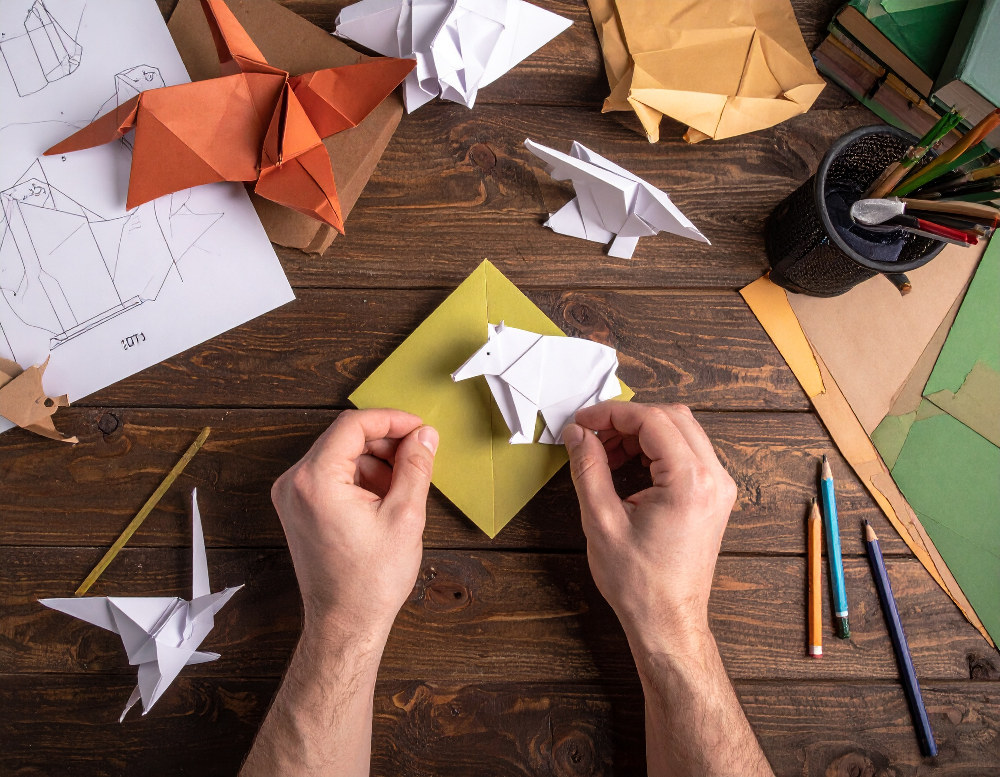

```{=html}
<section class="simposio-detalle-container">

<div class="detalle-breadcrumb">
<a href="../../index.html">⌂</a>
<span class="separator">›</span>
<a href="../../cursos.html">Talleres</a>
<span class="separator">›</span>
<span class="current">Mastogami: Animalitos en papel</span>
</div>

<article class="detalle-card">
<div class="detalle-grid">

<div class="col-izquierda">
<div class="imagen-card">

<div class="pie-foto">
📷  Plegar la ciencia para divulgar la mastofauna con arte y precisión.
</div>
</div>

<div class="organizadores-info">
<h3>Organizan</h3>
<ul class="lista-organizadores">
<li>Carolina López Castañeda</li>
</ul>
<div class="badge-simposio">Mastogami: Animalitos en papel</div>
</div>
</div>

<div class="col-derecha">
<h1>Mastogami: Animalitos en papel</h1>
<div class="subtitulo">VI Congreso Colombiano de Mastozoología · Amazonía 2026</div>

<div class="resumen">
<h2>Resumen</h2>
<p>El primer taller de Mastozoogami Busca crear un espacio creativo,  inmersión dinámica entre el papel y la morfología básica de los mamíferos a través de la precisión del plegado. Mediante la intersección de ciencia y arte (STEAM), los participantes lograrán visualmente estructuras biológicas complejas y convertirlas en esculturas de papel, dominando una herramienta de divulgación científica de alto impacto y bajo costo. Es la oportunidad perfecta para romper la rigidez académica, estimular la síntesis creativa y dotar a los investigadores de un recurso pedagógico innovador que cautiva a todas las audiencias. Haremos un mamífero terreste, uno acuático y un volador¡Pleguemos la ciencia y demos vida al papel!.</p>

</div>

 <!-- ==== fin instructor 1 ==== -->
<div class="wrap">
  <h1 class="section-title">Instructores</h1>
 
  <div class="list">
    <details class="instructor">
      <summary class="row">
        <div class="row-text">
          <p class="name">Carolina López Castañeda </p>
          <p class="role">PhD. Universidad Surcolombiana. Colombia</p>
        </div>
      </summary>
      <div class="panel-inner">
        <div class="expand-card">
          <div class="card-top">
            <div class="avatar">
              
            </div>
          </div>
          <div class="card-body">
            <p class="name">Carolina López Castañeda</p>
            <p class="role"> </p>
 
            <div class="credential-row">
              <span class="credential"> </span>
              <span class="credential"></span>
            </div>
             <p class="bio">
             Carolina López Castañeda es Bióloga con mención en zoología y Doctora en Ciencias Biológicas de la Universidad del Valle. Como profesional ha sido investigadora, docente universitaria, coordinadora ambiental y consultora en biología de la conservación con especialización en ecología, sistemas de información geográfica  y el  estudio de los murciélagos. Adicional a su experiencia académica, ha practicado origami desde su infancia y ha participado en cursos nacionales. En los últimos años ha usado el origami como una herramienta pedagógica innovadora para enseñar conceptos de biología, ecología y  biogeografía. Además de explorar sus aplicaciones en bisutería y decoración. En esta edición del Congreso Colombiano de Mastozoología habrá un taller diseñado para inspirar y conectar a investigadores, estudiantes y al público general con la biodiversidad mediante la creación de una figura de mamífero terrestre, así como uno acuático y otro volador. Esta actividad incluirá material.
            </p>
             <div class="tools">
              </div>
            </div>
        </div>
      </div>
    </details>
    </div>
    </div>
    <!-- ==== fin instructor 1 ==== -->

<a href="../../cursos.html" class="btn-volver">← Volver a todos los talleres</a>
</div>

</div>
</article>
</section>
```
<script src="t7_mastogami.js"></script>
