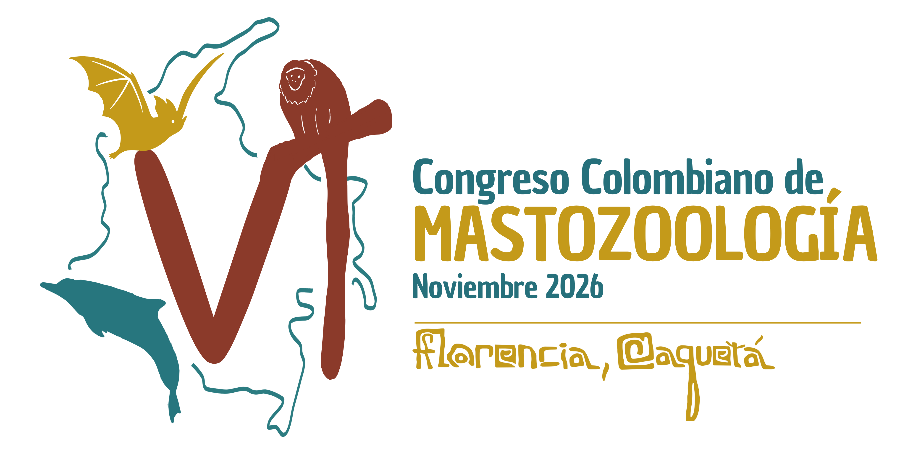
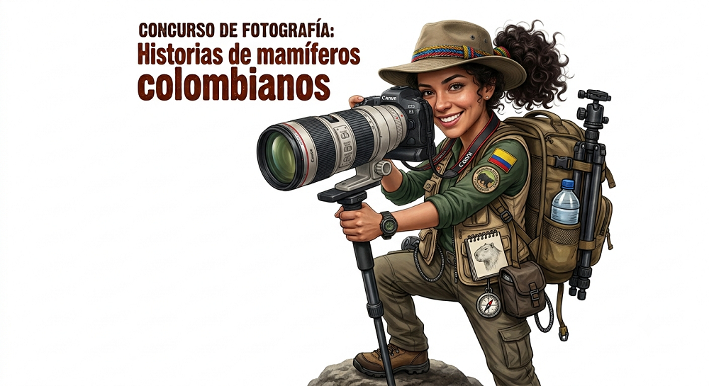
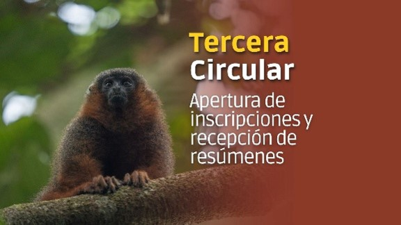
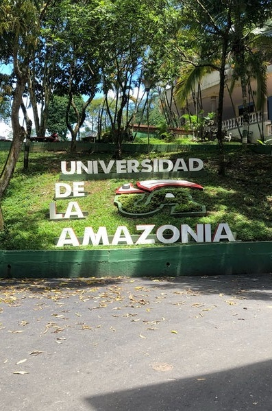
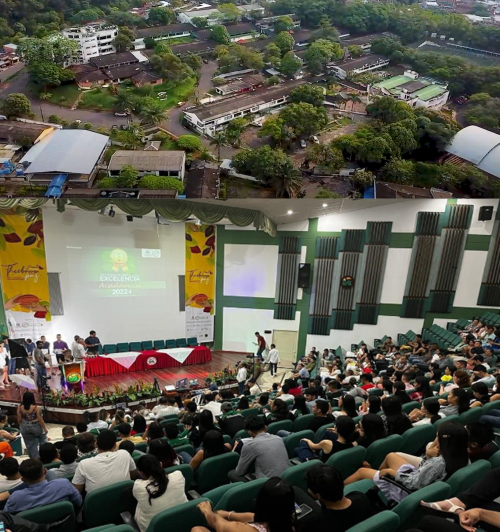

```{=html}
<div class="aviso-overlay" id="avisoOverlay">
    <div class="aviso-caja" role="dialog" aria-modal="true" aria-labelledby="avisoTitulo">
      <div class="aviso-encabezado">
        <h2 id="avisoTitulo">📢 Fechas importantes del evento</h2>
        <button class="aviso-cerrar" id="avisoCerrarX" aria-label="Cerrar">&times;</button>
      </div>
      
      
      
      <div class="aviso-pestanas">
  <button class="aviso-pestana-btn activo" data-aviso-tab="fechas" type="button">
    Fechas importantes
  </button>
  <button class="aviso-pestana-btn" data-aviso-tab="tarifas" type="button">
    Tarifas vigentes
  </button>
</div>
      
      <div class="aviso-cuerpo">
        
           <!-- ===== Panel 1  ===== -->
           <div class="aviso-panel activo" data-aviso-panel="fechas">
           
        <span class="aviso-etiqueta">Fechas importantes</span>
 
        <div class="aviso-fecha-bloque">
          <p class="aviso-fecha-titulo">LÍMITE PAGO AUTORES</p>
          <p class="aviso-fecha-dato">23 de octubre de 2026</p>
        </div>
 
        <div class="aviso-fecha-bloque">
          <p class="aviso-fecha-titulo">FECHA PAGO TERCERA ETAPA </p>
          <p class="aviso-fecha-dato">02 de noviembre de 2026</p>
        </div>
 
        <p class="aviso-urgencia">¡No te quedes por fuera!</p>
 
        <div class="aviso-botones">
          <a href="https://forms.gle/PyvaCTigHpFzCad39" target="_blank" rel="noopener noreferrer" class="aviso-boton-accion aviso-boton-inscribete">
            Inscríbete
          </a>
          </div>
          </div>
          
          <!-- ===== Panel 2  ===== -->
          
          <div class="aviso-panel" data-aviso-panel="tarifas">

    <span class="aviso-etiqueta">Tarifas vigentes</span>

    <div class="aviso-panel-scroll">

      <p class="aviso-tarifa-grupo-titulo">Solino · Tarifa individual</p>

      <span class="aviso-tarifa-tag">Socios</span>
      <div class="aviso-tarifa-scroll">
        <table>
  <thead>
    <tr>
      <th>Categoría</th>
      <th>Etapa 1<br>(4 sep)</th>
      <th>Etapa 2<br>(3 oct)</th>
      <th>Etapa 3<br>(2 nov)</th>
    </tr>
  </thead>
  <tbody>
    <tr>
      <td class="aviso-tarifa-fila-nombre">Estudiante/recién graduado/comunidades*</td>
      <td>$360.000</td><td>$410.000</td><td>$450.000</td>
    </tr>
    <tr>
      <td class="aviso-tarifa-fila-nombre">Estudiante posgrado/profesional</td>
      <td>$420.000</td><td>$490.000</td><td>$530.000</td>
    </tr>
  </tbody>
</table>
      </div>

      <span class="aviso-tarifa-tag" style="margin-top:10px;">No socios</span>
      <div class="aviso-tarifa-scroll">
        <table>
  <thead>
    <tr>
      <th>Categoría</th>
      <th>Etapa 1<br>(4 sep)</th>
      <th>Etapa 2<br>(3 oct)</th>
      <th>Etapa 3<br>(2 nov)</th>
    </tr>
  </thead>
  <tbody>
    <tr>
      <td class="aviso-tarifa-fila-nombre">Estudiante/recién graduado</td>
      <td>$460.000</td><td>$530.000</td><td>$580.000</td>
    </tr>
    <tr>
      <td class="aviso-tarifa-fila-nombre">Estudiante posgrado/profesional</td>
      <td>$590.000</td><td>$680.000</td><td>$740.000</td>
    </tr>
  </tbody>
</table>
      </div>

      <p class="aviso-tarifa-grupo-titulo">Cerrillos · Tarifa grupal</p>

      <span class="aviso-tarifa-tag">Socios</span>
      <div class="aviso-tarifa-scroll">
        <table>
  <thead>
    <tr>
      <th>Categoría</th>
       <th>Etapa 1<br>(4 sep)</th><th>Et.1 ·<br> 10 pers.</th>
      <th>Etapa 2<br>(3 oct)</th><th>Et.1 · <br> 10 pers.</th>
      <th>Etapa 3<br>(2 nov)</th><th>Et.1 · <br> 10 pers.</th>
    </tr>
  </thead>
  <tbody>
    <tr>
      <td class="aviso-tarifa-fila-nombre">Estudiante/recién graduado/comunidades*</td>
      <td>$340.000</td><td>$310.000</td>
      <td>$390.000</td><td>$370.000</td>
      <td>$430.000</td><td>$420.000</td>
    </tr>
    <tr>
      <td class="aviso-tarifa-fila-nombre">Estudiante posgrado/profesional</td>
      <td>$400.000</td><td>$370.000</td>
      <td>$460.000</td><td>$430.000</td>
      <td>$510.000</td><td>$500.000</td>
    </tr>
  </tbody>
</table>
      </div>

      <span class="aviso-tarifa-tag" style="margin-top:10px;">No socios</span>
      <div class="aviso-tarifa-scroll">
        <table>
  <thead>
    <tr>
      <th>Categoría</th>
      <th>Etapa 1<br>(4 sep)</th><th>Et.1 · <br> 10 pers.</th>
      <th>Etapa 2<br>(3 oct)</th><th>Et.1 · <br> 10 pers.</th>
      <th>Etapa 3<br>(2 nov)</th><th>Et.1 · <br> 10 pers.</th>
    </tr>
  </thead>
  <tbody>
    <tr>
      <td class="aviso-tarifa-fila-nombre">Estudiante/recién graduado</td>
      <td>$440.000</td><td>$410.000</td>
      <td>$510.000</td><td>$480.000</td>
      <td>$560.000</td><td>$550.000</td>
    </tr>
    <tr>
      <td class="aviso-tarifa-fila-nombre">Estudiante posgrado/profesional</td>
      <td>$550.000</td><td>$520.000</td>
      <td>$640.000</td><td>$600.000</td>
      <td>$720.000</td><td>$690.000</td>
    </tr>
  </tbody>
</table>
      </div>

      <p class="aviso-tarifa-hint">← Desliza cada tabla para ver todas las columnas</p>

    </div>

  </div>

        
        
      </div>
      <div class="aviso-pie">
        <button class="aviso-boton" id="avisoCerrarBtn">Entendido</button>
      </div>
      
      
      
      
      
      
    </div>
  </div>


<section class="home-hero">
  <div class="hero-overlay"></div>
  <div class="hero-inner">
    <div class="hero-badge reveal">Florencia, Caquetá</div>
    
    <p class="hero-subtitle reveal">
      VI Congreso Colombiano de Mastozoología · 2 al 6 de noviembre de 2026
    </p>

    <div class="hero-actions reveal">
      <a href="https://forms.gle/XxFNRAio8Wap7W3W6/" target="_blank" rel="noopener noreferrer" class="hero-btn hero-btn-primary">
        Inscríbete
      </a>
      <a href="noticias.html" class="hero-btn hero-btn-secondary">
        Ver noticias
      </a>
    </div>
  </div>

  <div class="hero-scroll-indicator">
    <span></span>
  </div>
  
  </section>

<section class="home-intro section-block">
  <div class="section-shell intro-shell">
    <div class="intro-copy reveal">
      <span style="font-weight: 800;"  class="section-kicker">Bienvenidos</span>
      <h2 class="section-heading">La mastozoologia se da cita en Florencia, Caquetá, Puerta de Oro de la Amazonia Colombiana. </h2>
      <p style="text-align: justify;">
        El Congreso Colombiano de Mastozoología se celebra cada dos años y sus sedes se alternan de manera itinerante en distintas regiones biogeográficas de Colombia, con el propósito de visibilizar la riqueza natural y cultural de cada territorio, así como fortalecer el desarrollo de las distintas formas de construcción de conocimiento y de gestión de la biodiversidad de mamíferos.
      </p>
      <p style="text-align: justify;" >
        Para esta sexta edición la sede será la Amazonía colombiana, una región reconocida mundialmente por su extraordinaria biodiversidad y por ser el hogar de comunidades que han tejido una relación profunda con la naturaleza.
      </p>
    </div>
    
    <div class="intro-highlight reveal">
      <div class="highlight-card">
        <div class="highlight-text">
          <strong>VI Congreso Colombiano</strong>
          <span>Un espacio para ciencia, territorio, biodiversidad y saberes compartidos.</span>
        </div>
      </div>
       <!-- ===========  WIDGET  ============== -->
       <div class="fc-card" role="complementary" aria-label="Fechas clave del congreso">
    <p class="fc-eyebrow">Cronograma</p>
    <p class="fc-title">Fechas clave — VI Congreso</p>
    <ul class="fc-timeline">
      <li class="is-done">
        <span class="fc-date">28 Ago 2026</span>
        <span class="fc-desc">Límite de envío de resúmenes</span>
      </li>
      <li class="is-done" >
        <span class="fc-date">18 Sep 2026</span>
        <span class="fc-desc">Notificación de aceptación</span>
      </li>
      <li class="is-next">
        <span class="fc-date">23 Oct 2026</span>
        <span class="fc-desc">Plazo máximo de pago para autores</span>
      </li>
      <li>
        <span class="fc-date">2–6 Nov 2026</span>
        <span class="fc-desc">Congreso</span>
      </li>
    </ul>
  </div>
   <!-- ===========  WIDGET  ============== -->
     
    </div>
    
   
    
     <div class="objetivos">
    <h2>Objetivos</h2>
    <p style="text-align: justify;" >El VICCM tiene como propósito consolidar un espacio dinámico de intercambio académico, científico y cultural en torno al conocimiento de los mamíferos, fortaleciendo la investigación, el diálogo interdisciplinar, intergeneracional e intercultural, así como la divulgación del conocimiento sobre la mastofauna del país. Asimismo, busca fomentar la integración entre la ciencia, la cultura y la sociedad, generando un escenario que promueva la construcción colectiva de saberes y el fortalecimiento de acciones orientadas a la investigación, la conservación y manejo de los mamíferos en el territorio colombiano.</p>
     <br>
    <p>En este sentido, se busca:</p>
    <br>
    <ul class="lista-objetivos">
    <li style="text-align: justify;" >Facilitar un espacio para el intercambio de experiencias, la construcción de conocimiento sobre diferentes ramas y saberes sobre los mamíferos desde lo local a lo global.</li>
    <li style="text-align: justify;" >Incentivar y fortalecer las redes de colaboración entre personas, grupos, comunidades, colectivos y organizaciones que investigan, estudian, y se interesan o desarrollan experiencias en la gestión de la biodiversidad de mamíferos.</li>
    <li style="text-align: justify;" >Fomentar espacios de discusión sobre los desafíos actuales y emergentes para el estudio y la conservación de la mastofauna en Colombia y América Latina, proponiendo estrategias que integren ciencia, política y sociedad.</li>
    <li style="text-align: justify;" >Promover la apropiación social del conocimiento mediante actividades científicas culturales y de divulgación que reconozcan la relación entre los mamíferos, las comunidades humanas y todas las expresiones de biodiversidad.</li>
    </ul>
    
    </div>
  </div>
  
  
 
</section>


<section class="home-news section-block">
  <div class="section-shell">
    <div class="section-header reveal">
      <span class="section-kicker">Actualidad</span>
      <h2 class="section-heading">Últimas Noticias</h2>
      <p class="section-description">Consulta convocatorias, circulares y anuncios más recientes del congreso.</p>
    </div>

    <div class="news-grid">
    
    
     <article class="news-card reveal">
        <div class="news-image">
          
        </div>
        <div class="news-content">
          <span class="news-date">17 Julio 2026</span>
          <h3>Concurso de Fotografía</h3>
          <p>Con tus fotografías, puedes contribuir a que los mamíferos se conozcan mejor y a conservar nuestra fauna.</p>
          <a href="noticias/2026-07-17_Concurso_Fotografia/concurso_fotografia.html" class="news-link">Leer más</a>
        </div>
      </article>
      
    
     <article class="news-card reveal">
        <div class="news-image">
          
        </div>
        <div class="news-content">
          <span class="news-date">18 Junio 2026</span>
          <h3>Tercera Circular</h3>
          <p>Ya está disponible la tercera circular con información actualizada del congreso.</p>
          <a href="noticias/2026-07-14_tercera_circular/tercera_circular.html" class="news-link">Leer más</a>
        </div>
      </article>


      <article class="news-card reveal">
        <div class="news-image">
          
        </div>
        <div class="news-content">
          <span class="news-date">04 Julio 2026</span>
          <h3 class="anchored">II Encuentro de Semilleros de Mastozoología Colombiana</h3>
          <p>El II Encuentro de Semilleros de Mastozoología Colombiana.</p>
          <a href="/noticias/2026-04-06_encuentro_semilleros/encuentro_semilleros.html" class="news-link">Leer más</a>
        </div>
      </article>
      </div>


  

       <div class="quick-icons reveal">
  <div class="quick-icon-card" data-modal="conferencistas">
    <div class="quick-icon">🎤</div>
    <span>Conferencistas</span>
  </div>

  <a href="noticias/2026-07-14_tercera_circular/tercera_circular.html#fechas-claves"><div class="quick-icon-card">
        <div class="quick-icon">📅</div>
        <span>Fechas clave</span>
      </div></a>

  <div class="quick-icon-card" data-modal="eventos">
    <div class="quick-icon">🌿</div>
    <span>Eventos</span>
  </div>
</div>

<!-- Overlay + Modal -->
<div class="modal-overlay" id="modalOverlay">
  <div class="modal-box" id="modalBox">
    <button class="modal-close" id="modalClose">&times;</button>
    <div id="modalContent"></div>
  </div>
</div>

<style>
  .quick-icon-card {
    cursor: pointer;
    transition: transform 0.2s ease, box-shadow 0.2s ease;
  }

  .quick-icon-card:hover {
    transform: translateY(-4px);
    box-shadow: 0 8px 20px rgba(0,0,0,0.12);
  }

  .modal-overlay {
    position: fixed;
    inset: 0;
    background: rgba(0,0,0,0.5);
    backdrop-filter: blur(3px);
    display: flex;
    align-items: center;
    justify-content: center;
    opacity: 0;
    visibility: hidden;
    transition: opacity 0.25s ease, visibility 0.25s ease;
    z-index: 1000;
  }

  .modal-overlay.active {
    opacity: 1;
    visibility: visible;
  }

  .modal-box {
    background: #fff;
    border-radius: 16px;
    padding: 2rem;
    max-width: 480px;
    width: 90%;
    position: relative;
    transform: scale(0.85) translateY(20px);
    opacity: 0;
    transition: transform 0.3s cubic-bezier(0.34, 1.56, 0.64, 1), opacity 0.3s ease;
    box-shadow: 0 20px 50px rgba(0,0,0,0.25);
  }

  .modal-overlay.active .modal-box {
    transform: scale(1) translateY(0);
    opacity: 1;
  }

  .modal-close {
    position: absolute;
    top: 12px;
    right: 16px;
    background: none;
    border: none;
    font-size: 1.6rem;
    cursor: pointer;
    color: #888;
    transition: color 0.2s ease, transform 0.2s ease;
  }

  .modal-close:hover {
    color: #333;
    transform: rotate(90deg);
  }

  #modalContent h3 {
    margin-top: 0;
    color: #2c7a4b; /* ajústalo a tu paleta */
  }
</style>

<script>
  const modalData = {
    conferencistas: {
      title: "🎤 Conferencistas",
      body: "<p>Proximamente mas información </p>"
    },
   /* fechas: {
      title: "📅 Fechas clave",
      body: "<p>Consulta las fechas importantes del evento: inscripciones, entrega de trabajos y jornadas principales.</p>"
    },*/
    eventos: {
      title: "🌿 Eventos",
      body: "<p>Proximamente mas información </p>"
    }
  };

  const overlay = document.getElementById('modalOverlay');
  const modalContent = document.getElementById('modalContent');
  const closeBtn = document.getElementById('modalClose');

  document.querySelectorAll('.quick-icon-card').forEach(card => {
    card.addEventListener('click', () => {
      const key = card.dataset.modal;
      const data = modalData[key];
      if (!data) return;

      modalContent.innerHTML = `<h3>${data.title}</h3>${data.body}`;
      overlay.classList.add('active');
    });
  });

  function closeModal() {
    overlay.classList.remove('active');
  }

  closeBtn.addEventListener('click', closeModal);
  overlay.addEventListener('click', (e) => {
    if (e.target === overlay) closeModal();
  });

  document.addEventListener('keydown', (e) => {
    if (e.key === 'Escape') closeModal();
  });
</script>


      
     
      
      
      
    </div>
  </div>
</section>

<section class="home-abstracts section-block">
  <div class="section-shell abstracts-shell">
    <div class="abstracts-copy reveal">
      <span class="section-kicker light">Participación Académica</span>
      <h2 class="section-heading light">Resúmenes</h2>
      <p class="section-description light">
        Prepara y envía tu resumen a través de la plataforma oficial del congreso.
      </p>
    </div>

    <div class="abstracts-grid">
      <div class="abstract-card reveal">
        <div class="abstract-icon">📝</div>
        <h3>Preparar Resumen</h3>
        <p>Guías y plantillas para preparar correctamente tu propuesta académica.</p>
        <a href="noticias/2026-07-14_tercera_circular/tercera_circular.html#envio-resumenes2" target="_blank" rel="noopener noreferrer" class="abstract-btn">
          Preparar
        </a>
      </div>

      <div class="abstract-card reveal">
        <div class="abstract-icon">📤</div>
        <h3>Enviar Resumen</h3>
        <p>Accede a la plataforma oficial para enviar tu resumen al VICCM 2026.</p>
        <a href="https://mamiferoscolombia.org/openconf/openconf.php" target="_blank" rel="noopener noreferrer" class="abstract-btn">
          Enviar
        </a>
      </div>
    </div>
  </div>
</section>

<section class="home-register section-block">
  <div class="section-shell">
    <div class="register-card reveal">
      <div class="register-icon">✍️</div>
      <h2>¡Inscríbete Ahora!</h2>
      <p>Asegura tu participación en el congreso más importante de mastozoología en Colombia.</p>
      <a href="https://forms.gle/XxFNRAio8Wap7W3W6" target="_blank" rel="noopener noreferrer" class="register-btn">
        INSCRÍBETE AQUÍ
      </a>
    </div>
  </div>
</section>

<section class="home-venue section-block">
  <div class="section-shell">
    <div class="section-header reveal">
      <span class="section-kicker">Sede</span>
      <h2 class="section-heading">Ubicación del Congreso</h2>
      <p class="section-description">Universidad de la Amazonia · Florencia, Caquetá</p>
    </div>

    <div class="venue-grid">
      <div class="venue-gallery reveal">
        <div class="venue-slider" id="venueSlider">
          
          
          
        </div>
        <div class="venue-dots" id="venueDots"></div>
      </div>

      <div class="venue-map reveal">
        <iframe
          src="https://www.google.com/maps/embed?pb=!1m18!1m12!1m3!1d4730.82210175032!2d-75.60683052432172!3d1.62013236064601!2m3!1f0!2f0!3f0!3m2!1i1024!2i768!4f13.1!3m3!1m2!1s0x8e244e2307a3b2af%3A0x2eb9e14897cad6c7!2sUniversidad%20de%20la%20Amazonia%20sede%20principal!5e1!3m2!1ses!2sco!4v1775502218616!5m2!1ses!2sco"
          loading="lazy"
          referrerpolicy="no-referrer-when-downgrade"
          allowfullscreen="">
        </iframe>
      </div>
    </div>
  </div>
</section>

<section class="home-values section-block">
  <div class="section-shell">
    <div class="section-header reveal">
      <span class="section-kicker">Nuestros valores</span>
      <h2 class="section-heading">Nosotros Valoramos</h2>
      <p class="section-description">Principios que orientan la experiencia del VICCM 2026.</p>
    </div>

    <div class="values-grid">
      <article class="value-card reveal">
        <div class="value-icon">🤝</div>
        <h3>La Integridad</h3>
        <p>
          El intercambio abierto de ideas y la libertad de pensamiento y expresión son fundamentales para los objetivos y metas del VICCM 2026; estos requieren un entorno que reconozca el valor inherente de cada persona y grupo, que fomente la dignidad, la comprensión y el respeto mutuo, y que abrace la diversidad.
        </p>
      </article>

      <article class="value-card reveal">
        <div class="value-icon">🔎</div>
        <h3>Transparencia Científica</h3>
        <p>
          La transparencia es necesaria para una ciencia reproducible. Promovemos que las decisiones, los métodos y los protocolos sean claros, transparentes y reproducibles, desde la fase de planificación hasta el análisis y resultado final.
        </p>
      </article>

      <article class="value-card reveal">
        <div class="value-icon">🧪</div>
        <h3>Métodos Robustos</h3>
        <p>
          Ningún método ni procedimiento analítico es perfecto. Valoramos la consideración de las fortalezas y limitaciones de cada método o análisis, favoreciendo resultados sólidos y decisiones informadas.
        </p>
      </article>
    </div>
  </div>
</section>
```
