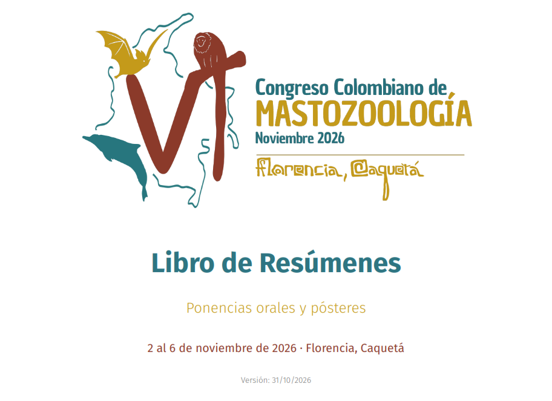

```{=html}
<section class="noticia-container">

<div class="detalle-breadcrumb">
<a href="../../index.html">⌂</a>
<span class="separator">›</span>
<a href="../../noticias.html">Noticias</a>
<span class="separator">›</span>
<span class="current">Libro de Resúmenes</span>
</div>

<article class="noticia-card">

<div class="noticia-header">
<div class="noticia-header-content">
<h1 class="noticia-titulo">Libro de Resúmenes</h1>
<div class="noticia-meta">
<span>15 Julio 2026</span>
<span>5:00 p.m</span>
</div>
</div>
</div>

<div class="noticia-body">

<a class="autor-destacado" href="../../comites.html">
<div class="autor-avatar">

</div>
<div class="autor-info">
<h3>Diego J. Lizcano</h3>
<p>Autor de la noticia</p>
<small>Haz clic para ver el comité</small>
</div>
</a>
<h2 class="apertura">Libro de Resúmenes</h2>
<p>Este libro reúne los resúmenes de los trabajos que se presentarán en el VI Congreso Colombiano
de Mastozoología, que se realizará del 2 al 6 de noviembre de 2026 en Florencia, Caquetá. El
congreso es un espacio de encuentro para quienes estudian, conservan y manejan los mamíferos
de Colombia, y busca fortalecer el intercambio de conocimiento entre investigadores, estudiantes, instituciones y comunidades.</p>

<p>La edición actual incluye 291 resúmenes (233 ponencias orales y 58 pósteres) de trabajos cuya
inscripción se encuentra pagada hasta el dia: Viernes 30 de Octubre 2026. Estos Resumenes estan distribuidos en 27 simposios temáticos. Los pósteres se presentan en la sesión de cada simposio, entre las 18:00 y las 19:00.</p>

<div class="modalidad-card">

</div>


<div class="botones-container">

<a href="https://mamiferoscolombia.org/VICCM/noticias/2026-10-30_Resumenes/files/VICCM-libro-resumenes.pdf" target="_blank" rel="noopener noreferrer" class="btn-animado btn-descargar">
<span>📄</span>
<span>Descarga el Libro de Resúmenes</span>
</a>
</div>


<div class="detalle-nav">

<a href="../../noticias.html">
<div class="label">Anterior</div>
<div class="title">Noticias</div>
</a>


</div>

</div>
</article>
</section>
```
<script src="resumenes.js"></script>