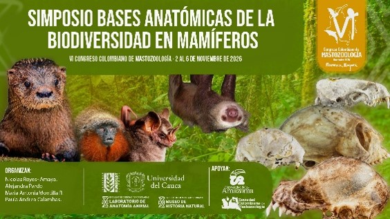

```{=html}
<section class="simposio-detalle-container">

<div class="detalle-breadcrumb">
<a href="../../index.html">⌂</a>
<span class="separator">›</span>
<a href="../../simposios.html">Simposios</a>
<span class="separator">›</span>
<span class="current">Bases Anatómicas de la Biodiversidad en Mamíferos</span>
</div>

<article class="detalle-card">
<div class="detalle-grid">

<div class="col-izquierda">
<div class="imagen-card">

<div class="pie-foto">
📷 Anatomía comparada y nuevas tecnologías para el estudio morfológico de mamíferos.
</div>
</div>

<div class="organizadores-info">
<h3>Organizan</h3>
<ul class="lista-organizadores">
<li>Nicolas Reyes-Amaya</li>
<li>Alejandra Pardo</li>
<li>Paula Calambas Pizo</li>
<li>Maria Antonia Montilla</li>
</ul>
<div class="badge-simposio">Simposio Bases Anatómicas de la Biodiversidad en Mamíferos</div>
</div>

<div class="simposio-logos" >


</div>


</div>

<div class="col-derecha">
<h1>Simposio Bases Anatómicas de la Biodiversidad en Mamíferos</h1>
<div class="subtitulo">VI Congreso Colombiano de Mastozoología · Florencia 2026</div>

<div class="objetivos">
<h2>Objetivo</h2>
<ul class="lista-objetivos">
<li style="text-align: justify; margin-bottom: 5px; " >Promover un espacio de intercambio académico y científico sobre el estudio de la anatomía y la morfología de los mamíferos desde una perspectiva evolutiva, integrando avances metodológicos y conceptuales que contribuyan a comprender los procesos de desarrollo, diversificación y evolución del fenotipo mamífero. </li>

<li style="text-align: justify; margin-bottom: 5px; " >Reunir investigaciones que aborden la anatomía, morfología y evolución de los mamíferos mediante enfoques clásicos y técnicas analíticas contemporáneas.. </li>

<li style="text-align: justify; margin-bottom: 5px; ">Fomentar el diálogo interdisciplinario entre investigadores que emplean herramientas como histomorfología, morfometría tradicional, morfometría geométrica, tomografía computarizada (ct), análisis de modularidad e integración morfológica. </li>

<li style="text-align: justify; margin-bottom: 5px; ">Promover la discusión de estudios orientados a comprender los mecanismos de cambio morfológico desde escalas ontogenéticas, poblacionales y macroevolutivas, incluyendo especies actuales y extintas. </li>

<li style="text-align: justify; margin-bottom: 5px; ">Incentivar el intercambio de experiencias y perspectivas que fortalezcan la investigación en anatomía comparada, biología evolutiva y mastozoología.</li>
</ul>
</div>

<div class="resumen">
<h2>Resumen</h2>
<p>La anatomía comparada de los mamíferos ha constituido una herramienta fundamental para comprender la diversidad biológica, establecer relaciones evolutivas e interpretar los procesos que han dado origen a la variación morfológica. En las últimas décadas, el desarrollo de nuevas metodologías analíticas y tecnologías de visualización ha ampliado significativamente las posibilidades para estudiar la forma desde una perspectiva cuantitativa e integradora, fortaleciendo la interacción entre la anatomía, la biología evolutiva y la ecología.</p>

<p> Este simposio propone un espacio de intercambio científico orientado a investigaciones que exploren la morfología de los mamíferos desde diferentes aproximaciones y escalas de análisis. Se recibirán contribuciones que incorporen herramientas como histomorfología, morfometría tradicional, morfometría geométrica, tomografía computarizada (CT), análisis de integración y modularidad, así como otras metodologías que permitan comprender los procesos de desarrollo, morfogénesis y evolución del fenotipo. </p>

<p> El simposio busca promover el diálogo entre investigadores interesados en los mecanismos que generan y mantienen la diversidad morfológica, abordando preguntas relacionadas con la ontogenia, la evolución del desarrollo, la variación intra e interespecífica, la adaptación, la disparidad morfológica y los patrones macroevolutivos. Se invita a presentar estudios desarrollados tanto en especies actuales como extintas, desde diferentes niveles de organización biológica, contribuyendo a consolidar un espacio de discusión especializado sobre la evolución de la forma en mamíferos y su relevancia para la sistemática, la evolución y la conservación de la biodiversidad.</p>

<h2>Instituto Humbolt</h2>

<!-- Redes sociales -->
        
            <div class="redes-iconos">

                <a href="https://www.facebook.com/instituto.humboldt/?locale=es_LA&_rdc=2&_rdr#" class="red-social facebook"
                   target="_blank" aria-label="Facebook">
                    <i class="fa-brands fa-facebook-f"></i>
                </a>

                <a href="https://www.instagram.com/instituto_humboldt/" class="red-social instagram"
                   target="_blank" aria-label="Instagram">
                    <i class="fa-brands fa-instagram"></i>
                </a>

                
                <a href="https://www.instagram.com/instituto_humboldt/" class="red-social x"
                   target="_blank" aria-label="X">
                    <i class="fa-brands fa-x-twitter"></i>
                </a>

               <!-- <a href="#" class="red-social linkedin"
                   target="_blank" aria-label="LinkedIn">
                    <i class="fa-brands fa-linkedin-in"></i>
                </a> -->

                <a href="https://www.humboldt.org.co/" class="red-social whatsapp"
                   target="_blank" aria-label="WhatsApp">
                    <i class="fa-solid fa-globe"></i>
                </a>

            </div>
            
<h2>Universidad del Cauca</h2>

<!-- Redes sociales -->
        
            <div class="redes-iconos">

                <a href="https://www.facebook.com/universidadelcauca" class="red-social facebook"
                   target="_blank" aria-label="Facebook">
                    <i class="fa-brands fa-facebook-f"></i>
                </a>

                <a href="https://www.instagram.com/universidadelcauca?igsh=dmEwdDl1eGM1MjB2" class="red-social instagram"
                   target="_blank" aria-label="Instagram">
                    <i class="fa-brands fa-instagram"></i>
                </a>

                
                <a href="https://x.com/unicauca" class="red-social x"
                   target="_blank" aria-label="X">
                    <i class="fa-brands fa-x-twitter"></i>
                </a>

               <!-- <a href="#" class="red-social linkedin"
                   target="_blank" aria-label="LinkedIn">
                    <i class="fa-brands fa-linkedin-in"></i>
                </a> -->

                <a href="https://www.unicauca.edu.co/" class="red-social whatsapp"
                   target="_blank" aria-label="WhatsApp">
                    <i class="fa-solid fa-globe"></i>
                </a>

            </div>
            
<h2>Universidad de la Amazonia</h2>

<!-- Redes sociales -->
        
            <div class="redes-iconos">

                <a href="https://www.facebook.com/uniamazonia.edu.co?rdid=1hoEV8coPAlQODpo&share_url=https%3A%2F%2Fwww.facebook.com%2Fshare%2F19FBdLQ3Rb%2F#" class="red-social facebook"
                   target="_blank" aria-label="Facebook">
                    <i class="fa-brands fa-facebook-f"></i>
                </a>

                <a href="https://www.instagram.com/uniamazonia/" class="red-social instagram"
                   target="_blank" aria-label="Instagram">
                    <i class="fa-brands fa-instagram"></i>
                </a>

                
               <!-- <a href="#" class="red-social linkedin"
                   target="_blank" aria-label="LinkedIn">
                    <i class="fa-brands fa-linkedin-in"></i>
                </a> -->

                <a href="https://www.uniamazonia.edu.co/Inicio/index.php/es/" class="red-social whatsapp"
                   target="_blank" aria-label="WhatsApp">
                    <i class="fa-solid fa-globe"></i>
                </a>

            </div>


<a href="../../simposios.html" class="btn-volver">← Volver a todos los simposios</a>
</div>

</div>
</article>
</section>
```
<script src="bases_anatomicas.js"></script>
