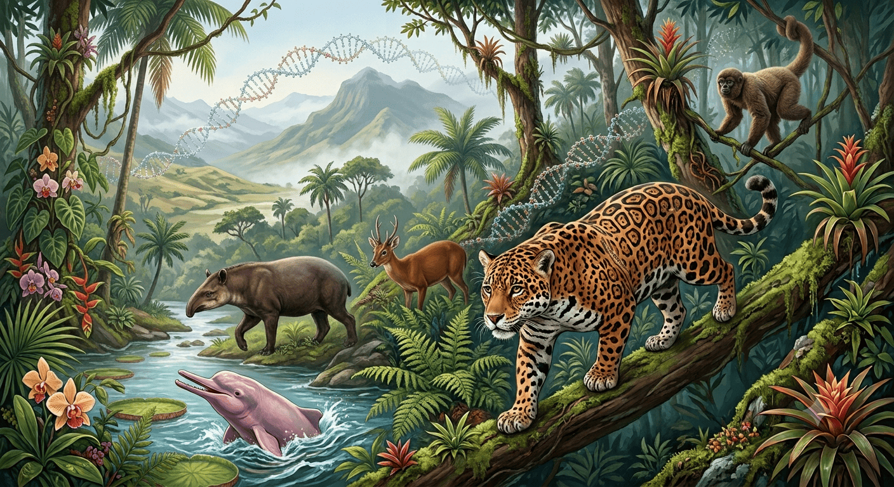

```{=html}
<section class="simposio-detalle-container">

<div class="detalle-breadcrumb">
<a href="../../index.html">⌂</a>
<span class="separator">›</span>
<a href="../../simposios.html">Simposios</a>
<span class="separator">›</span>
<span class="current">Genética y genómica de mamíferos colombianos</span>
</div>

<article class="detalle-card">
<div class="detalle-grid">

<div class="col-izquierda">
<div class="imagen-card">

<div class="pie-foto">
📷 Genómica y conservación: el ADN de los mamíferos colombianos.
</div>
</div>

<div class="organizadores-info">
<h3>Organizan</h3>
<ul class="lista-organizadores">
<li>Alejandra Bonilla-Sánchez</li>
<li>Paola Pulido-Santacruz</li>
<li>Laura M. Aramendiz-Macías</li>
<li>Sergio Penagos</li>
<li>Alejandra Niño-Reyes</li>
<li>Gabriel Pantoja</li>
</ul>
<div class="badge-simposio">II Simposio de Genética y genómica de mamíferos colombianos: diversidad, evolución y conservación</div>
</div>

<div class="simposio-logos" >


</div>

</div>

<div class="col-derecha">
<h1>II Simposio de Genética y genómica de mamíferos colombianos: diversidad, evolución y conservación</h1>
<div class="subtitulo">VI Congreso Colombiano de Mastozoología · Florencia 2026</div>

<div class="objetivos">
<h2>Objetivo</h2>
<p>Promover el intercambio de avances científicos, metodológicos y aplicados relacionados con el uso de herramientas genéticas y genómicas en el estudio de la diversidad, evolución, ecología y conservación de mamíferos colombianos. </p>
</div>

<div class="resumen">
<h2>Resumen</h2>
<p>El simposio “Genética y genómica de mamíferos colombianos: diversidad, evolución y conservación 2026” será un espacio de intercambio científico enfocado en los avances recientes de la genética y la genómica aplicadas al estudio de los mamíferos colombianos. A través de presentaciones y discusiones interdisciplinarias, el evento abordará cómo las nuevas tecnologías de secuenciación y las herramientas bioinformáticas han transformado la comprensión de los procesos evolutivos, ecológicos y biogeográficos que estructuran la diversidad de mamíferos en el Neotrópico.</p>
<p>El simposio reunirá investigaciones relacionadas con diversidad genética, historia evolutiva, filogeografía, delimitación de especies, conectividad poblacional, adaptación y conservación, resaltando el papel de la información genética y genómica en la evaluación del estado de conservación y en la generación de estrategias más eficientes para el manejo y protección de las especies. Asimismo, se discutirán los desafíos asociados a la integración de datos, el fortalecimiento de colecciones y bases de datos genéticas, y la necesidad de ampliar redes de colaboración entre investigadores e instituciones en Colombia.</p>
<p>Además de divulgar avances científicos y metodológicos, el evento buscará promover la articulación académica y el intercambio de experiencias entre estudiantes, investigadores y profesionales interesados en el estudio y conservación de los mamíferos colombianos, fortaleciendo el papel de la genética y la genómica como herramientas fundamentales para la investigación y conservación de la biodiversidad del país.</p>
</div>


 <!-- ==== fin instructor 1 ==== -->
<div class="wrap">
  <h1 class="section-title">Ponente Magistral</h1>
 
  <div class="list">
    <details class="instructor">
      <summary class="row">
        <div class="row-text">
          <p class="name">Daniel Eduardo Chávez Viteri</p>
          <p class="role">Docente de la Facultad de Ciencias Exactas, Naturales y Ambientales</p>
        </div>
      </summary>
      <div class="panel-inner">
        <div class="expand-card">
          <div class="card-top">
            <div class="avatar">
              
            </div>
          </div>
          <div class="card-body">
            <p class="name">Daniel Eduardo Chávez Viteriy</p>
            <p class="role"> </p>
 
            <div class="credential-row">
              <span class="credential">PhD - Faculty of Exact and Natural Sciences Ecology</span>
              
            </div>
             <p class="bio">
              Daniel Eduardo Chávez Viteri es investigador y docente de la Facultad de Ciencias Exactas, Naturales y Ambientales de la Pontificia Universidad Católica del Ecuador, donde integra el Grupo de Ecología, Conservación y Sistemática. Su trabajo científico se enfoca en la evolución, conservación y genómica comparativa de vertebrados, especialmente mamíferos y otros organismos neotropicales, utilizando herramientas genómicas de alta resolución para comprender procesos evolutivos, adaptación, historia demográfica y conservación de especies.

Su trayectoria académica incluye investigaciones de alcance internacional relacionadas con la genómica evolutiva de cánidos sudamericanos, adaptación molecular y conservación de especies amenazadas. Entre sus contribuciones más destacadas se encuentra el estudio comparativo de genomas de cánidos sudamericanos publicado en Proceedings of the National Academy of Sciences of the United States of America, donde se exploró la historia evolutiva y las adaptaciones moleculares de este grupo. Asimismo, ha participado en investigaciones sobre el rascón de Galápagos y en el desarrollo de metodologías de identificación genética rápida aplicadas a museos y zoológicos, fortaleciendo herramientas para la conservación y sistemática de especies en países megadiversos.

Además de su producción científica, su trabajo ha contribuido al fortalecimiento de iniciativas de investigación y conservación en Ecuador, particularmente en el ámbito de la mastozoología y el uso de recursos genéticos para el estudio de la biodiversidad. Su perfil combina investigación en biología evolutiva, conservación y bioinformática, promoviendo la integración entre nuevas tecnologías genómicas y aplicaciones prácticas para el manejo y conservación de la fauna silvestre neotropical.
            </p>
             <div class="tools">
              </div>
            </div>
        </div>
      </div>
    </details>
    </div>
    </div>
    <!-- ==== fin instructor 1 ==== -->
    


<a href="../../simposios.html" class="btn-volver">← Volver a todos los simposios</a>
</div>

</div>
</article>
</section>
```
<script src="genetica_genomica.js"></script>
