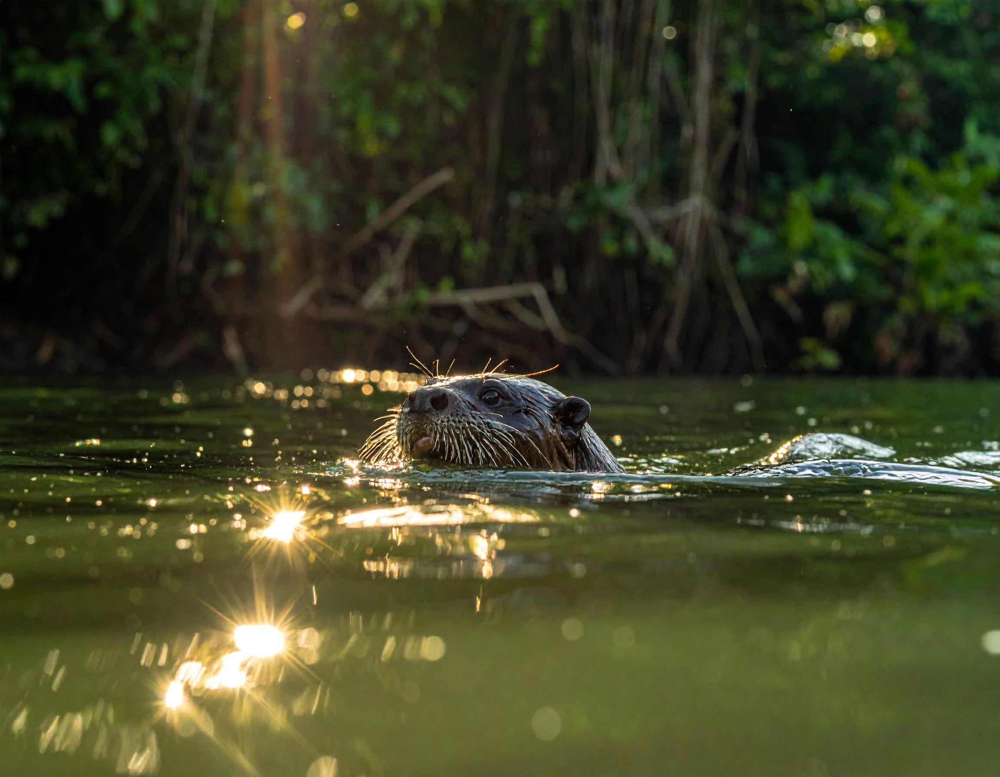

```{=html}
<section class="simposio-detalle-container">

<div class="detalle-breadcrumb">
<a href="../../index.html">⌂</a>
<span class="separator">›</span>
<a href="../../simposios.html">Simposios</a>
<span class="separator">›</span>
<span class="current">Conservación de Mamíferos Acuáticos y Asociados al Agua en el Neotrópico</span>
</div>

<article class="detalle-card">
<div class="detalle-grid">

<div class="col-izquierda">
<div class="imagen-card">

<div class="pie-foto">
📷 Ecosistemas acuáticos y su conservación en el Neotrópico.
</div>
</div>

<div class="organizadores-info">
<h3>Organizan</h3>
<ul class="lista-organizadores">
<li>Federico Mosquera Guerra</li>
<li>Fernando Trujillo</li>
<li>Carlos Saavedra</li>
<li>Karen Pérez Albarracín </li>
</ul>
<div class="badge-simposio">Conservación de Mamíferos Acuáticos y Asociados al Agua en el Neotrópico</div>
</div>

<div class="simposio-logos" >


</div>
</div>

<div class="col-derecha">
<h1>Conservación de Mamíferos Acuáticos y Asociados al Agua en el Neotrópico</h1>
<div class="subtitulo">VI Congreso Colombiano de Mastozoología · Florencia 2026</div>

<div class="objetivos">
<h2>Objetivo</h2>
<p>Generar un espacio de intercambio científico, técnico y social sobre el estado del conocimiento, la conservación y el manejo de los mamíferos acuáticos y semiacuáticos presentes en ecosistemas marinos, costeros, fluviales y humedales del Neotrópico, promoviendo el diálogo entre investigadores, estudiantes, autoridades ambientales, organizaciones sociales y comunidades locales para fortalecer redes de colaboración, enfoques interdisciplinarios y estrategias integrales de conservación. </p>
</div>

<div class="resumen">
<h2>Resumen</h2>
<p>El simposio abordará avances recientes en ecología, distribución, monitoreo, amenazas emergentes, restauración de hábitats y conservación de cetáceos, sirénidos, nutrias y otros mamíferos asociados a ecosistemas acuáticos. Asimismo, propiciará la discusión sobre los efectos del cambio climático, la contaminación, la pérdida de conectividad ecológica, la pesca incidental y la transformación de los ecosistemas acuáticos en el Neotrópico. La realización de este espacio responde a la importancia ecológica de estos mamíferos como reguladores tróficos, dispersores de nutrientes e indicadores de la salud ecosistémica, así como a la necesidad de reducir los vacíos de información y fortalecer la articulación entre investigación, manejo y conservación. Finalmente, el simposio contribuirá a visibilizar experiencias regionales, identificar prioridades de investigación y promover la construcción colectiva de estrategias para la conservación de los mamíferos acuáticos y los ecosistemas asociados en el Neotrópico.</p>


<!-- ==== fin instructor 1 ==== -->
<div class="wrap">
  <h1 class="section-title">Ponente Magistral</h1>
 
  <div class="list">
    <details class="instructor">
      <summary class="row">
        <div class="row-text">
          <p class="name">Fernando Trujillo Gonzalez</p>
          <p class="role">Fundación Omacha - Colombia</p>
        </div>
      </summary>
      <div class="panel-inner">
        <div class="expand-card">
          <div class="card-top">
            <div class="avatar">
              
            </div>
          </div>
          <div class="card-body">
            <p class="name">Fernando Trujillo Gonzalez</p>
            <p class="role">Fundador de la Fundación Omacha </p>
 
            <div class="credential-row">
              <span class="credential">Biólogo Marino de la Universidad Jorge Tadeo Lozano</span>
              <span class="credential">Mg. Ciencias Ambientales en la Universidad de Greenwich (Londres, Reino Unido)</span>
              <span class="credential">PhD. Zoología en la Universidad de Aberdeen (Escocia)</span>
              
            </div>
             <p class="bio">
              Socio fundador de la Fundación Omacha, Biólogo Marino de la Universidad Jorge Tadeo Lozano, con Maestría en Ciencias Ambientales en la Universidad de Greenwich (Londres, Reino Unido) y Doctorado en Zoología en la Universidad de Aberdeen (Escocia). Su especialidad es la ecología acuática con énfasis en vertebrados acuáticos. De experiencia reconocida en el desarrollo de Planes de Manejo de Áreas Protegidas y Especies Amenazadas, en monitoreo de fauna y evaluaciones de impacto ambiental, acuerdos y ordenamiento pesquero, y tóxicos en sistemas acuáticos y humedales.

A recibido muchos premios y reconocimientos entre los que se destaca el Whitley Gold Award 2007, uno más prestigiosos reconocimientos ambientales en el ámbito internacional, por su trabajo a favor de la conservación de los delfines de río; el cual recibió en la Real Sociedad Geográfica de Londres (Inglaterra).

En el año 2024, fue nombrado como Explorador del Año Rolex National Geographic
            </p>
             <div class="tools">
              </div>
            </div>
        </div>
      </div>
    </details>
    </div>
    </div>
    <!-- ==== fin instructor 1 ==== -->

</div>

<a href="../../simposios.html" class="btn-volver">← Volver a todos los simposios</a>
</div>

</div>
</article>
</section>
```
<script src="mamiferos_acuaticos.js"></script>
