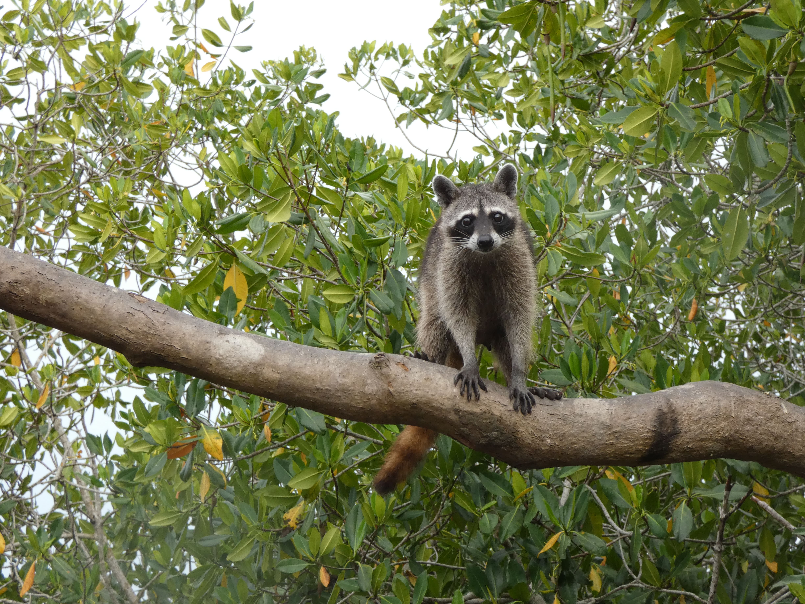

```{=html}
<section class="simposio-detalle-container">

<div class="detalle-breadcrumb">
<a href="../../index.html">⌂</a>
<span class="separator">›</span>
<a href="../../simposios.html">Simposios</a>
<span class="separator">›</span>
<span class="current">Avances en el Estudio de la Mastofauna del Caribe Colombiano</span>
</div>

<article class="detalle-card">
<div class="detalle-grid">

<div class="col-izquierda">
<div class="imagen-card">

<div class="pie-foto">
📷 Avances en el estudio de la mastofauna del Caribe colombiano.
</div>
</div>

<div class="organizadores-info">
<h3>Organizan</h3>
<ul class="lista-organizadores">
<li>Julio Javier Chacón Pacheco</li>
<li>Angie Natally Tinoco Sotomayor</li>
<li>Gerson Andrés Salcedo Rivera</li>
<li>María Isabel Maya Aguirre</li>
<li>Julián David Ruiz Gómez</li>
</ul>
<div class="badge-simposio">Avances en el estudio de la mastofauna del Caribe colombiano</div>
</div>

<div class="simposio-logos" >


</div>

</div>

<div class="col-derecha">
<h1>Avances en el Estudio de la Mastofauna del Caribe Colombiano</h1>
<div class="subtitulo">VI Congreso Colombiano de Mastozoología · Florencia 2026</div>

<div class="objetivos">
<h2>Objetivo General</h2>
<p>Fortalecer el conocimiento, la articulación y la proyección de la investigación sobre la mastofauna del Caribe colombiano mediante un espacio de intercambio científico que reúna a investigadores, estudiantes e instituciones para socializar avances, reconocer la trayectoria de la disciplina y promover alianzas orientadas a la conservación y el desarrollo de nuevas iniciativas de investigación.</p>

<h2>Objetivos Especificos</h2>
<ul class="lista-objetivos">
<li>Socializar los avances científicos más recientes sobre la diversidad, ecología, conservación y manejo de la mastofauna del Caribe colombiano, a través de la presentación de investigaciones desarrolladas en la región.</li>

<li>Reconstruir y visibilizar la trayectoria histórica de la mastozoología en el Caribe colombiano, destacando los principales investigadores, proyectos e hitos que han contribuido al conocimiento de los mamíferos de la región.</li>

<li>Promover el intercambio de experiencias y conocimientos entre investigadores nacionales e internacionales, estudiantes y profesionales, fortaleciendo el diálogo intergeneracional y la construcción de redes de colaboración.</li>

<li>Fomentar la vinculación de estudiantes y jóvenes investigadores a la mastozoología mediante espacios de interacción, discusión científica y acercamiento con investigadores de amplia trayectoria.</li>

<li>Impulsar la generación de alianzas estratégicas y la formulación de propuestas colaborativas que fortalezcan la investigación, el monitoreo y la conservación de la mastofauna del Caribe colombiano, identificando retos y oportunidades para el desarrollo futuro de esta disciplina en la región.</li>
</ul>
</div>

<div class="resumen">
<h2>Resumen</h2>
<p>El simposio “Avances en la investigación de la mastofauna del Caribe colombiano” se propone como un espacio académico para reunir a investigadores, estudiantes, profesionales e instituciones interesados en el estudio y la conservación de los mamíferos de la región Caribe. Su propósito es socializar los avances científicos más recientes, visibilizar el trabajo desarrollado por diferentes grupos de investigación y fortalecer la articulación entre quienes han contribuido al conocimiento de la mastofauna regional desde diversas disciplinas y enfoques.</p>

<p>El evento incluirá ponencias sobre investigaciones recientes en ecología, taxonomía, conservación, monitoreo y manejo de mamíferos, así como un conversatorio con investigadores de trayectoria que permita reconstruir la historia de la mastozoología en el Caribe colombiano, identificar los principales hitos de esta disciplina y reflexionar sobre los desafíos y oportunidades para su desarrollo. Este diálogo intergeneracional favorecerá el intercambio de experiencias entre investigadores consolidados, jóvenes científicos y estudiantes, promoviendo la construcción de redes de colaboración y el fortalecimiento de nuevas capacidades.</p>

<p>Además de difundir el conocimiento científico generado en la región, el simposio busca identificar vacíos de investigación, fomentar alianzas entre universidades, centros de investigación, organizaciones ambientales y entidades gubernamentales, e impulsar iniciativas colaborativas que contribuyan a la conservación de la biodiversidad. De esta manera, el simposio pretende consolidarse como un escenario de referencia para la integración de la comunidad mastozoológica del Caribe colombiano y para la definición de una agenda conjunta que fortalezca la investigación, el monitoreo y la conservación de la mastofauna regional.
</p>

</div>

<a href="../../simposios.html" class="btn-volver">← Volver a todos los simposios</a>
</div>

</div>
</article>
</section>
```
<script src="mastofauna_caribe.js"></script>
