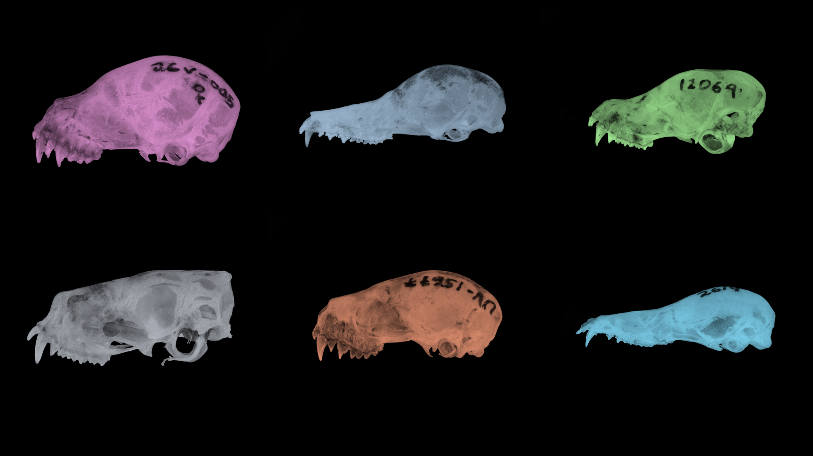

```{=html}
<section class="simposio-detalle-container">

<div class="detalle-breadcrumb">
<a href="../../index.html">⌂</a>
<span class="separator">›</span>
<a href="../../simposios.html">Simposios</a>
<span class="separator">›</span>
<span class="current">VI Simposio Colombiano de Quiropterología</span>
</div>

<article class="detalle-card">
<div class="detalle-grid">

<div class="col-izquierda">
<div class="imagen-card">

<div class="pie-foto">
📷 Murciélagos colombianos: ciencia y conservación desde la diversidad. 
</div>
</div>

<div class="organizadores-info">
<h3>Organizan</h3>
<ul class="lista-organizadores">
<li>Sebastián Montoya-Bustamante</li>
<li>Natalya Zapata-Mesa</li>
<li>María A. Hurtado-Materón</li>
</ul>
<div class="badge-simposio">VI Simposio Colombiano de Quiropterología</div>
</div>

<div class="simposio-logos" >


</div>
</div>

<div class="col-derecha">
<h1>VI Simposio Colombiano de Quiropterología</h1>
<div class="subtitulo">VI Congreso Colombiano de Mastozoología · Florencia 2026</div>

<div class="objetivos">
<h2>Objetivo</h2>
<ul class="lista-objetivos">
<li>Evaluar el estado actual del conocimiento sobre los murciélagos de Colombia y definir prioridades de investigación que fortalezcan su conservación.</li>
<li>Articular a investigadores, estudiantes y entidades para consolidar redes de colaboración que integren avances en sistemática, ecología y fisiología.</li>
</div>

<div class="resumen">
<h2>Resumen</h2>
<p>Los murciélagos representan uno de los grupos de mamíferos más diversos y ecológicamente importantes del planeta, y Colombia destaca por albergar una de las quiropterofaunas más ricas del mundo. A pesar de su relevancia, estas especies continúan enfrentando amenazas crecientes asociadas a la pérdida y transformación de hábitat, el cambio climático y la persistente desinformación sobre su papel en los ecosistemas. Desde la realización del último Simposio Colombiano de Quiropterología han transcurrido cinco años marcados por avances significativos en el estudio de este grupo, lo que hace necesario un nuevo espacio académico que permita actualizar el panorama nacional, identificar vacíos de información y orientar las líneas de investigación futuras.
El VI Simposio se plantea como un encuentro integrador que reúna a investigadores, estudiantes, organizaciones no gubernamentales y entidades gubernamentales en torno a una visión conjunta de la quiropterología en el país. Su propósito central es articular los progresos recientes en sistemática, ecología y fisiología, disciplinas cuya convergencia resulta esencial para diseñar estrategias de conservación efectivas. Asimismo, busca fortalecer redes de colaboración entre actores del ámbito académico, ambiental y de política pública, incrementando la capacidad colectiva de respuesta frente a las amenazas que enfrentan los murciélagos. En conjunto, el evento aspira a consolidarse como un espacio de síntesis, diálogo y proyección científica que impulse la investigación y conservación de estos mamíferos en Colombia.

</div>

<a href="../../simposios.html" class="btn-volver">← Volver a todos los simposios</a>
</div>

</div>
</article>
</section>
```
<script src="quiropterologia.js"></script>
